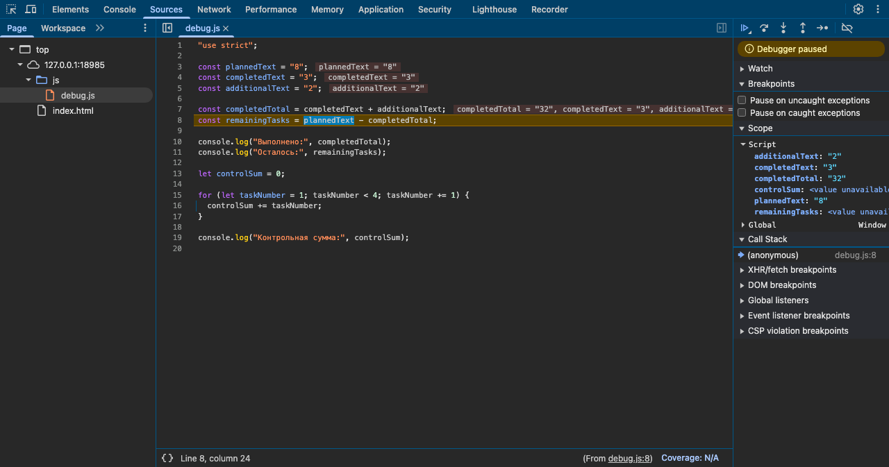

# ПР1. Окружение и первые программы на JavaScript

| | |
|---|---|
| Автор | Мухамбетов Алим, ЭФБО-13-25 |
| Вариант | 1: `totalTasks = 12`, `completedTasks = 5`, `dailyLimit = 3` |
| ОС | macOS 26.5.1 |
| Node.js / npm / Git | v24.14.1 / 11.11.0 / 2.50.1 |
| Браузер | Google Chrome 156 |
| Дополнительное задание | вариант Б, план с выходными (`js/plan-week.js`) |

## Запуск

Все команды из корня репозитория:

```bash
node practice-01/js/hello.js
node practice-01/js/types.js
node practice-01/js/progress.js
node practice-01/js/plan.js
node practice-01/js/debug.js
node practice-01/js/plan-week.js
```

Браузер: открыть `practice-01/index.html` как файл, F12 → Console. Для другого задания
заменить в `index.html` путь `./js/hello.js` на нужный файл, сохранить и перезагрузить
страницу. Подключается всегда один файл: у заданий 3 и 4 совпадают имена констант верхнего
уровня. В сдаваемой версии подключён `hello.js`.

Все шесть файлов проверены в обеих средах, вывод совпадает построчно, кроме последней строки
задания 1.

## Задание 1. Две среды

| Где запущено | Где вывод | Последняя строка |
|---|---|---|
| `node practice-01/js/hello.js` | терминал | `Тип document: undefined` |
| `index.html` в Chrome | DevTools → Console (на странице только заголовок и два абзаца) | `Тип document: object` |

`document` — объект DOM, его создаёт браузер для загруженной страницы. Node.js выполняет тот
же язык, но без страницы, поэтому такого глобального объекта там нет. `typeof` для
необъявленного имени не бросает `ReferenceError`, а возвращает `"undefined"`, поэтому строка
работает в обеих средах.

## Задание 2. Типы и преобразования

Колонка «Ожидание» заполнена до запуска.

| Выражение | Ожидание | Факт | Тип | Почему |
|---|---|---|---|---|
| `"8" + 2` | `"82"` | `82` | string | `+` со строкой хотя бы с одной стороны — склейка: 2 превращается в `"2"` |
| `"8" - 2` | `6` | `6` | number | у `-` нет строкового смысла, оба операнда приводятся к числу |
| `Number("8") + 2` | `10` | `10` | number | явное преобразование, дальше обычное сложение чисел |
| `"12" > "3"` | `false` | `false` | boolean | две строки сравниваются посимвольно: `"1"` (код 49) меньше `"3"` (51) |
| `12 === "12"` | `false` | `false` | boolean | строгое равенство не приводит типы: number ≠ string |
| `Number("")` | `0` | `0` | number | пустая строка (и строка из пробелов) по правилам `Number` даёт 0, а не `NaN` |
| `Number("text")` | `NaN` | `NaN` | number | строку нельзя прочитать как число; `NaN` — значение типа number |
| `Boolean("false")` | `true` | `true` | boolean | ложна только пустая строка, содержимое не анализируется |
| `typeof null` | `"object"` | `object` | string | историческая ошибка языка, `null` — примитив; результат `typeof` всегда строка |
| `typeof NaN` | `"number"` | `number` | string | `NaN` — специальное числовое значение; сам ответ `typeof` снова строка |

Самый неочевидный пункт — шестой: `Number("")` равен 0, поэтому пустое поле формы без
отдельной проверки превращается в «ноль задач».

## Задание 3. Сводка (`progress.js`)

Проверки идут цепочкой от типа к границам, первая сработавшая задаёт текст ошибки. Ноль задач
обрабатывается до деления. Статус берётся из исходных количеств, процент только для вывода
(`toFixed(1)`).

| Вход (`total`, `completed`) | Ожидание | Факт | Итог |
|---|---|---|---|
| **12, 5 (вариант)** | осталось 7, 41.7%, «В работе» | `Осталось: 7 / Прогресс: 41.7% / Статус: В работе` | пройдено |
| 0, 0 | «Задач пока нет», без процента | `Задач пока нет` | пройдено |
| 5, 0 | осталось 5, 0.0%, «Не начато» | `Осталось: 5 / Прогресс: 0.0% / Статус: Не начато` | пройдено |
| 5, 5 | осталось 0, 100.0%, «Завершено» | `Осталось: 0 / Прогресс: 100.0% / Статус: Завершено` | пройдено |
| 5, 6 | ошибка: выполнено больше | `Ошибка: выполнено больше задач, чем существует.` | пройдено |
| -1, 0 | ошибка: отрицательное | `Ошибка: количество задач не может быть отрицательным.` | пройдено |
| 5, 2.5 | ошибка: дробное | `Ошибка: количество задач не может быть дробным.` | пройдено |
| "5", 2 | ошибка: строка | `Ошибка: количество задач должно быть числом, а не строкой или другим типом.` | пройдено |
| 1001, 0 | ошибка: верхняя граница | `Ошибка: задач больше допустимых 1000.` | пройдено |
| NaN, 0 | ошибка: не число | `Ошибка: недопустимое числовое значение (NaN или Infinity).` | пройдено |
| 1000, 999 (своя) | граница, 99.9%, «В работе» | `Осталось: 1 / Прогресс: 99.9% / Статус: В работе` | пройдено |
| 0, 1 (своя) | ошибка: выполнено больше | `Ошибка: выполнено больше задач, чем существует.` | пройдено |
| Infinity, 0 (своя) | ошибка: не конечное число | `Ошибка: недопустимое числовое значение (NaN или Infinity).` | пройдено |

`NaN` отдельно ловится через `Number.isFinite`: `typeof NaN === "number"`, а сравнения с ним
всегда ложны, поэтому проверки `< 0` и `> 1000` его бы пропустили.

## Задание 4. План по дням (`plan.js`)

Цикл `while` идёт, пока остаток больше нуля; за день берётся `Math.min(dailyLimit, remaining)`.
Норма проверяется до цикла и не меньше 1, поэтому остаток строго убывает и цикл конечен.

| Вход (`total`, `completed`, `limit`) | Ожидание | Факт | Итог |
|---|---|---|---|
| **12, 5, 3 (вариант)** | 3 дня, в последний 1 задача | `День 3: выполнено 1, осталось 0 / Потребуется дней: 3` | пройдено |
| 10, 4, 3 | 2 дня по 3 | `День 1: выполнено 3, осталось 3 / День 2: выполнено 3, осталось 0 / Потребуется дней: 2` | пройдено |
| 5, 3, 10 | 1 день, только 2 задачи | `День 1: выполнено 2, осталось 0 / Потребуется дней: 1` | пройдено |
| 5, 5, 2 | 0 дней, без цикла | `Все задачи уже выполнены / Потребуется дней: 0` | пройдено |
| 0, 0, 2 | 0 дней, без цикла | `Задач нет / Потребуется дней: 0` | пройдено |
| 5, 2, 0 | ошибка | `Ошибка: дневная норма должна быть от 1 до 1000.` | пройдено |
| 5, 2, 1.5 | ошибка: дробная норма | `Ошибка: дневная норма должна быть целым числом.` | пройдено |
| 5, 6, 2 | ошибка: выполненных больше | `Ошибка: некорректное число выполненных задач: больше общего.` | пройдено |
| 5, 2, "2" | ошибка: норма строкой | `Ошибка: дневная норма должна быть числом, а не строкой.` | пройдено |
| 5, 2, 1001 | ошибка: верхняя граница | `Ошибка: дневная норма должна быть от 1 до 1000.` | пройдено |
| 5, 5, 0 (своя) | ошибка, хотя задач не осталось | `Ошибка: дневная норма должна быть от 1 до 1000.` | пройдено |
| 1000, 0, 1000 (своя) | обе границы, 1 день | `День 1: выполнено 1000, осталось 0 / Потребуется дней: 1` | пройдено |

Без проверки нормы набор `5, 2, 0` дал бы бесконечный цикл: остаток не уменьшается.

## Задание 5. Отладка (`debug.js`)

Исходный вывод (без исключений, но неверный):

```text
Выполнено: 32
Осталось: -24
Контрольная сумма: 6
```

Точка останова на строке 7 (`completedTotal = …`), перезагрузка, затем Step over. На снимке
программа стоит на строке 8: в Scope `completedText: "3"`, `additionalText: "2"`, а
`completedTotal: "32"` в кавычках, то есть строка. `remainingTasks` ещё недоступна (строка 8 не
выполнена).



Вторая точка, на строке 16 внутри цикла, срабатывает три раза: `taskNumber` 1, 2, 3 при
`controlSum` 0, 1, 3 до сложения. Четвёртой остановки нет: при `taskNumber = 4` условие
`4 < 4` ложно, цикл выходит с суммой 6.

| Ошибка | Что наблюдалось | Причина | Исправление | Результат |
|---|---|---|---|---|
| Обработка количества задач | `Выполнено: 32`, `Осталось: -24` | `+` склеил строки `"3"` и `"2"`; затем `"8" - "32"` привелось к числам: 8 − 32 | `Number(completedText) + Number(additionalText)`, `Number(plannedText) - …` | `Выполнено: 5`, `Осталось: 3` |
| Граница цикла | `Контрольная сумма: 6` | условие `< 4` исключает задачу 4 | `taskNumber <= 4` | `Контрольная сумма: 10` |

Вычитание «случайно» дало число, поэтому ошибка видна только по значению, а не по типу
итоговой переменной: `typeof remainingTasks` в исходной версии — `number`.

## Дополнительное задание: план с выходными (`plan-week.js`)

День 1 — понедельник, номер дня недели `(день - 1) % 7`, индексы 5 и 6 — выходные. Цикл
останавливается сразу после последней задачи, поэтому выходные в конце не добавляются.

| Вход | Ожидание | Факт | Итог |
|---|---|---|---|
| **6, 0, 1 (контрольный)** | 6 рабочих, 8 календарных | `Рабочих дней: 6 / Календарных дней: 8` | пройдено |
| 12, 5, 3 | 3 / 3, выходные не наступают | `День 3 (ср): выполнено 1 … Рабочих дней: 3 / Календарных дней: 3` | пройдено |
| 5, 0, 1 | 5 / 5, заканчивается в пятницу, без хвоста выходных | `День 5 (пт) … Рабочих дней: 5 / Календарных дней: 5` | пройдено |
| 11, 0, 2 | 6 / 8, последняя задача в понедельник | `День 8 (пн): выполнено 1 … Рабочих дней: 6 / Календарных дней: 8` | пройдено |
| 20, 0, 1 | 20 / 26, три выходных пары | `День 26 (пт) … Рабочих дней: 20 / Календарных дней: 26` | пройдено |
| 5, 5, 2 | 0 / 0 | `Рабочих дней: 0 / Календарных дней: 0` | пройдено |

## Вывод

Освоены запуск одного файла в Node.js и в браузере, строгий режим, явное преобразование типов,
проверка входных данных до вычислений и цикл с гарантированным завершением. Самой
показательной оказалась ошибка из задания 5: программа работала без исключений, а
неправильный результат стал виден только в отладчике по кавычкам у `"32"`. Отсюда правило,
применённое в заданиях 3 и 4: тип входных данных проверяется явно, а строки не приводятся к
числу молча.
