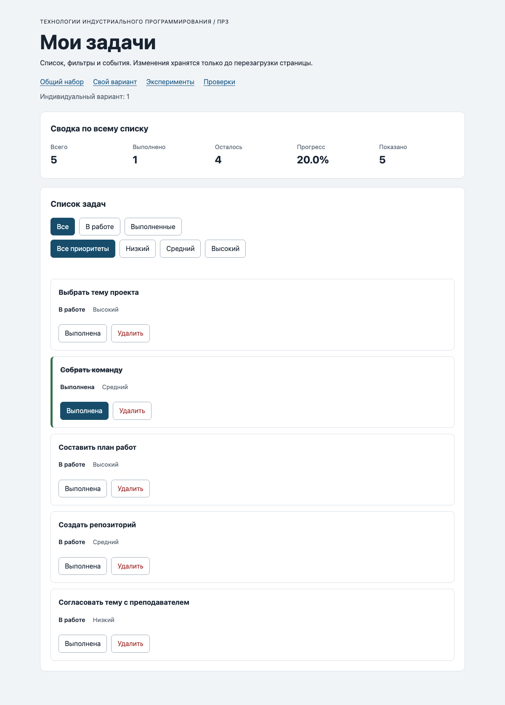

# Практическая работа № 3. Работа с DOM и событиями

## Данные работы

| Параметр | Значение |
|---|---|
| Студент | Мухамбетов Алим |
| Группа | ЭФБО-13-25 |
| Вариант | 1, подготовка учебного проекта |
| ОС | macOS 26.5.1, arm64 |
| Node.js | v24.14.1 |
| Браузер | Google Chrome 153 |

## Запуск

Из папки `practice-03`:

```bash
npm run check:service
npm start
```

После `npm start` открыть:

- приложение: http://127.0.0.1:5503/
- свой вариант: http://127.0.0.1:5503/index.html?dataset=variant
- эксперименты: http://127.0.0.1:5503/examples/dom-events.html
- проверки: http://127.0.0.1:5503/checks.html

Из корня репозитория проверка сервиса: `node practice-03/checks/service.checks.js`. Двойной щелчок по `index.html` не подходит, модули грузятся только через сервер.

## Что перенесено из ПР2

`src/task-service.js` и `src/data.js` скопированы из ПР2 без изменений. Проверки сервиса внутри ПР3 прошли (35 из 35), поэтому править их не пришлось.

## Эксперименты

| № | Прогноз | Факт | Объяснение |
|---:|---|---|---|
| 1 | `null` и `0` | `querySelector("#absent")` вернул `null`, длина пустой коллекции `0` | Пустую коллекцию можно обходить, у неё есть `length`. У `null` свойств нет, `null.textContent` даст `TypeError` |
| 2 | `"23"` строка, потом `23` число | `23 string`, после `Number` число `23` | Всё из `dataset` приходит строкой, поэтому `id` перед поиском надо перевести в число |
| 3 | старый список вырастет | старый `NodeList` остался `1`, новый `querySelectorAll` дал `2`, потом `3` | `querySelectorAll` возвращает снимок на момент вызова. Новые элементы в сохранённый список не попадают |
| 4 | слово выделится жирным | в заголовке видна строка `<strong>Это текст, а не HTML</strong>`, элемента `strong` внутри нет | `textContent` вставляет текст как есть, разметка не разбирается |
| 5 | сначала кнопка, потом карточка | `phase=1` у `lab-card`, `phase=3` у `lab-button`, `phase=3` у `lab-card`, везде `target=lab-label` | Клик был по `span`. Сначала идёт захват сверху (фаза 1), потом всплытие (фаза 3). Кнопка получает событие при всплытии, потому что `span` лежит внутри неё |

Поэтому обработчик на контейнере `#task-list` получает нажатия по любой кнопке внутри карточки, даже по подписи `span`. Нужную кнопку я нахожу через `closest("button[data-action]")`.

## Организация кода

| Файл | Что делает |
|---|---|
| `src/data.js` | общий набор и вариант (из ПР2) |
| `src/task-service.js` | функции ПР2, без DOM |
| `src/task-selectors.js` | `getVisibleTasks` по статусу и `filterByPriority` для расширения |
| `src/task-view.js` | карточка, список, сводка, пустое состояние; задачи не меняет |
| `src/main.js` | текущий массив, фильтры, обработчики кликов |

Обработчики подписаны один раз на контейнеры `#task-list`, `#task-filters` и `#priority-filters`. `renderApp` только перерисовывает, данные не трогает. Карточки собираются через `createElement` и `textContent`, `innerHTML` нигде нет.

## Общий сценарий

| Шаг | Действие | Ожидание | Факт | Итог |
|---:|---|---|---|---|
| 0 | исходный набор, «Все» | `[1, 4, 7, 10]`, 4 / 2 / 2 / 50.0% | `[1, 4, 7, 10]`, 4 / 2 / 2 / 50.0%, показано 4 | Пройдено |
| 1 | «В работе» | `[4, 7]`, 4 / 2 / 2 / 50.0% | `[4, 7]`, 4 / 2 / 2 / 50.0%, показано 2 | Пройдено |
| 2 | выполнить `id 4` | `[7]`, 4 / 3 / 1 / 75.0% | `[7]`, 4 / 3 / 1 / 75.0%, показано 1 | Пройдено |
| 3 | «Все» | `[1, 4, 7, 10]`, 4 / 3 / 1 / 75.0% | так и есть, показано 4 | Пройдено |
| 4 | удалить `id 7` | `[1, 4, 10]`, 3 / 3 / 0 / 100.0% | так и есть, показано 3 | Пройдено |
| 5 | «В работе» | `[]`, 3 / 3 / 0 / 100.0% | `[]`, 100.0%, «Нет задач по выбранному фильтру.» | Пройдено |
| 6 | «Все», переключить `id 1` | `[1, 4, 10]`, 3 / 2 / 1 / 66.7% | так и есть, показано 3 | Пройдено |
| 7 | удалить `1`, `4`, `10` | `[]`, 0 / 0 / 0 / 0.0% | `[]`, 0.0%, «Список задач пуст.» | Пройдено |

После перезагрузки снова шаг 0, сохранения в ПР3 нет.

Проверка отказов: в Elements поменял `data-task-id` карточки `4` на `777` и нажал «Выполнена». Появилось «Задача 777 не найдена», сводка осталась 4 / 2 / 2 / 50.0%. Потом поставил `4abc` и нажал «Удалить»: «Неверный id задачи», данные те же. `Number("4abc")` даёт `NaN`, а не `4`. После нажатия фильтра «Все» карточки пересоздались из массива, сообщение очистилось. Клик по названию задачи ничего не меняет.

## Индивидуальный вариант

Набор из `src/data.js`: шесть задач `[11, 23, 37, 41, 58, 64]`, ни одна не выполнена (вариант 1, K = 0).

| Шаг | Ожидание | Факт | Итог |
|---|---|---|---|
| Исходно | 6 / 0 / 6 / 0.0% | 6 / 0 / 6 / 0.0%, показано 6 | Пройдено |
| «В работе» | все шесть | шесть, показано 6 | Пройдено |
| «Выполненные» | пусто | `[]`, «Нет задач по выбранному фильтру.» | Пройдено |
| «Все», переключить `23` | 6 / 1 / 5 / 16.7% | 6 / 1 / 5 / 16.7% | Пройдено |
| Удалить `37` | `[11, 23, 41, 58, 64]`, 5 / 1 / 4 / 20.0% | так и есть | Пройдено |
| «Выполненные» / «В работе» | `[23]` / `[11, 41, 58, 64]` | `[23]` / `[11, 41, 58, 64]` | Пройдено |

Итог 20.0% совпадает с таблицей методички для варианта 1.

## Протокол проверки сервиса

```text
$ node checks/service.checks.js
...
OK: 33. Входные объекты не изменяются ни одной операцией
OK: 34. Общий сценарий и все промежуточные сводки
OK: 35. Работа с другим набором, без зависимости от demoTasks

Проверок пройдено: 35; не пройдено: 0.
```

Строки 01 до 32 такие же, как в ПР2, все `OK`.

## Протокол браузерных проверок

Текстовый протокол со страницы `checks.html` (20.10.2026):

```text
OK: Фильтр all возвращает новый массив в исходном порядке
OK: Фильтр pending выбирает невыполненные задачи
OK: Фильтр completed выбирает выполненные задачи
OK: Все три фильтра работают с пустым списком
OK: Фильтрация не меняет входные записи и их порядок
OK: Карточка — li.task-card с числовым id в dataset
OK: Статус невыполненной карточки и aria-pressed согласованы
OK: Статус выполненной карточки и aria-pressed согласованы
OK: В карточке две обычные кнопки с вложенными подписями
OK: Все приоритеты отображаются по установленному словарю
OK: Название с разметкой отображается текстом
OK: Отрисовка списка создаёт карточки в исходном порядке
OK: Повторная отрисовка не накапливает карточки
OK: Контейнер списка и его обработчик сохраняются
OK: Отрисовка пустого массива очищает прежние карточки
OK: Сводка считается по всему списку, отдельно выводится Показано
OK: Пустая сводка не содержит NaN и Infinity
OK: Сообщение для полностью пустого списка
OK: Сообщение для пустого результата фильтра
OK: Появление карточек скрывает прежнее пустое состояние
OK: Приложение: начальный набор и сводка
OK: Приложение: фильтр срабатывает по клику на вложенный span
OK: Приложение: активный фильтр отмечен классом и aria-pressed
OK: Приложение: фильтрация не удаляет скрытые задачи
OK: Приложение: переключение по id, а не индексу массива
OK: Приложение: выполненная задача исчезает из фильтра В работе
OK: Приложение: удаление изменяет данные, а не только DOM
OK: Приложение: клик по названию не изменяет данные
OK: Приложение: после перерисовок одно нажатие — одно изменение
OK: Приложение: удаление всех записей и нулевая сводка
OK: Приложение: нет совпадений — не то же самое, что нет задач
OK: Приложение: неизвестный числовой id не меняет данные
OK: Приложение: id 4abc не превращается в 4
OK: Приложение: неизвестное действие игнорируется
OK: Приложение: после изменения сохраняется клавиатурный фокус
OK: Приложение: новая загрузка возвращает исходное состояние

Всего: 36. Пройдено: 36. Ошибок: 0.
```

## Собственные проверки

| Проверка | Состояние и действие | Ожидание | Факт | Итог |
|---|---|---|---|---|
| Быстрые переключения | общий набор, 5 нажатий «Выполнена» у `id 7` подряд | нечётное число, `id 7` выполнена, 4 / 3 / 1 / 75.0% | 4 / 3 / 1 / 75.0% | Пройдено |
| Действие после смены фильтра | после прошлой проверки выполнены `1, 7, 10`; «Выполненные», снять выполнение у `id 10` | карточка `10` пропадает из фильтра, показано `[1, 7]`, общая 4 / 2 / 2 / 50.0% | показано `[1, 7]`, 4 / 2 / 2 / 50.0% | Пройдено |
| Название длиной 100 | `createTaskElement` с названием из 100 букв | в карточке все 100 символов, приоритет «Низкий» | `100 Низкий` | Пройдено |

## Отладка и клавиатура

Точка останова на строке `const id = Number(card?.dataset.taskId);` в `handleTaskListClick` при нажатии «Выполнена» у задачи 4: `card.dataset.taskId` это строка `"4"`, `id` число `4`, `action` равно `"toggle"`, `findTaskById` вернул `{ id: 4, title: "Подготовить модель задач", completed: false, priority: "high" }`. На следующей строке `result.ok === true`, в `result.tasks` новый массив, у задачи 4 `completed: true`, а старый `currentTasks` не изменился. Дальше `renderApp()` пересоздаёт карточки, и `restoreTaskFocus` возвращает фокус на кнопку той же задачи.

С клавиатуры: Tab доходит до кнопок карточки, Enter и пробел нажимают кнопку, после перерисовки фокус остаётся на той же кнопке (последняя браузерная проверка это тоже подтверждает).

## Вид приложения



## Дополнительное задание

Сделан вариант А: фильтр по приоритету. В `index.html` добавлена отдельная группа `#priority-filters` (все, низкий, средний, высокий), три основные кнопки остались в `#task-filters`. Фильтры работают вместе: сначала `getVisibleTasks` по статусу, потом `filterByPriority`. Сводка считается по всему массиву, «Показано» по совместной выборке.

| Проверка | Действие | Ожидание | Факт | Итог |
|---|---|---|---|---|
| Только приоритет | «Высокий» | `[4]`, показано 1, сводка 50.0% | `[4]`, показано 1, 50.0% | Пройдено |
| Нет совпадений | «Выполненные» + «Высокий» | пусто, «Нет задач по выбранному фильтру.» | так и есть | Пройдено |
| Выбор сохраняется после действия | «В работе» + «Высокий», выполнить `4` | `4` уходит из выборки, сводка 75.0% | `[]`, 75.0% | Пройдено |
| Сброс обоих | «Все» + «Все приоритеты» | `[1, 4, 7, 10]` | `[1, 4, 7, 10]` | Пройдено |

## Вывод

В ПР2 логика работала только в консоли, здесь к той же логике подключён интерфейс. Сервис остался без изменений, новое это отрисовка и обработка событий. Главное, что понял: интерфейс строится из массива, а не наоборот. Удаление карточки из DOM ничего не значит, если не вызвать `removeTask`. Фильтр меняет только то, что видно, поэтому сводка считается по полному `currentTasks`. Делегирование позволяет повесить один обработчик на список, и он работает с карточками, которых ещё не было при подписке.
