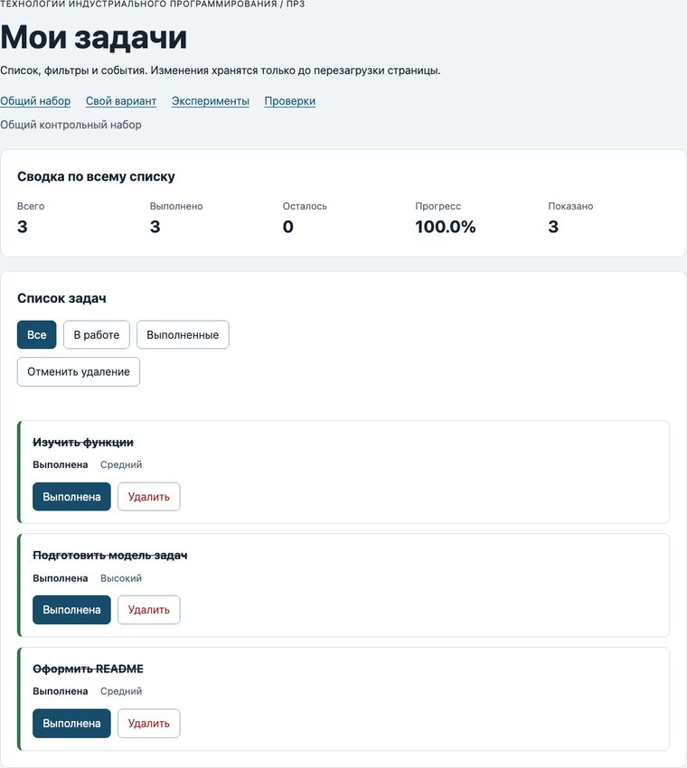

# ПР3. DOM, события и интерфейс списка задач

| | |
|---|---|
| Автор | Мухамбетов Алим, ЭФБО-13-25 |
| Вариант | 1: подготовка учебного проекта, `variantTasks` из ПР2, K = 0 |
| Окружение | macOS 26.5.1, Node.js v24.14.1, npm 11.11.0, Git 2.50.1, Chrome 156 |
| Проверено | 01.11.2026: функции ПР2 35/35, браузерные проверки 36/36 |
| Расширение | вариант Б, однократная отмена последнего удаления (`src/task-undo.js`) |



## Запуск

Рабочая папка `practice-03`, зависимостей нет:

```bash
cd practice-03
npm start                        # http://127.0.0.1:5503/
node tools/serve.mjs 5504        # если порт 5503 занят
npm run check:service            # функции ПР2 в Node
```

| Адрес | Что открывается |
|---|---|
| `/index.html` | общий набор из четырёх задач |
| `/index.html?dataset=variant` | шесть задач варианта 1 |
| `/examples/dom-events.html` | страница экспериментов |
| `/checks.html` | браузерные проверки, итог внизу страницы |

Двойной щелчок по `index.html` не подходит: страница открывается как `file://`, а модули
ES из такого адреса браузер не загружает. Папка самостоятельная: `task-service.js` и
`data.js` скопированы из ПР2, соседняя папка не нужна.

Сохранённые протоколы в `output/`: `service-checks.txt`, `browser-checks.txt`,
`ui-scenarios.txt` (все сценарии ниже), `devtools-debug.txt` (точки останова).

## Как устроено

| Модуль | Отвечает за | Чего не делает |
|---|---|---|
| `task-service.js` (ПР2) | операции над массивом, `{ ok, tasks }` или `{ ok, error }` | не знает про DOM |
| `task-selectors.js` | `FILTERS` и `getVisibleTasks(tasks, filter)` | не меняет данные |
| `task-view.js` | карточка, список, сводка, пустое состояние | не хранит состояние, не вешает обработчики |
| `task-undo.js` | запомнить удалённую запись и вернуть её на место | не трогает DOM |
| `main.js` | состояние (`currentTasks`, `currentFilter`, `lastRemoval`), события, вызов отрисовки | не строит разметку вручную |

Поток всегда один: событие → `runAction` вызывает сервис → при `ok` заменяется
`currentTasks` → `renderApp()` заново строит видимый список и сводку из массива. DOM
ничего не хранит, кроме `data-task-id` для поиска записи.

- Фильтры описаны объектом `FILTER_TESTS`, список `FILTERS` взят из его ключей, поэтому
  фильтр нельзя добавить в одно место и забыть в другом.
- Сводка считается по всему списку, «Показано» — по видимому.
- Текст попадает в карточку только через `textContent`, `innerHTML` в модулях нет.
- Обработчик один на весь `ul` (делегирование): карточки пересоздаются при каждой
  отрисовке, и навешивать события на каждую кнопку пришлось бы заново.

Разбор нажатия в `handleTaskListClick`:

1. `event.target` проверяется на `Element`, затем `closest("button[data-action]")`:
   клик по вложенному `span` всё равно находит кнопку, клик по названию или пустому месту
   карточки ничего не делает.
2. Кнопка должна лежать внутри списка (`list.contains`), действие — из белого списка
   `toggle`/`delete`.
3. `id` берётся из `closest("li[data-task-id]").dataset.taskId` (строка) и проходит
   `parseTaskId`: пусто → отказ, иначе `Number` и проверка «безопасное положительное
   целое». `"4abc"` даёт `NaN` и сообщение, а не тихий промах.
4. Отказ сервиса показывается в `#operation-message`, данные не меняются.
5. После отрисовки фокус возвращается на ту же кнопку той же задачи, если она осталась
   видимой. Иначе фокус остаётся на кнопке фильтра или на `body`.

## Задание 1. Эксперименты с DOM и событиями

Прогноз записан до запуска, факт получен в Chrome на `examples/dom-events.html`.

| № | Прогноз | Факт | Объяснение |
|---:|---|---|---|
| 1 | `null`; длина `0`; обращение к свойству `null` падает | `null`, `0`, `TypeError` | `querySelector` без совпадений возвращает `null`, а `querySelectorAll` пустой `NodeList`: у него есть `length` и `forEach`, ошибки нет |
| 2 | `"23"` строка, после `Number` число `23` | `23 string` → `23` | все значения `dataset` строки; для сравнения с `task.id` нужен `Number` |
| 3 | старый `NodeList` 1 и 1; новый поиск 2, затем 3 | `1 / 2`, затем `1 / 3` | `querySelectorAll` делает статический снимок; новые узлы видны только при новом поиске |
| 4 | в заголовке видна строка с `<strong>`, детей 0 | текст `<strong>Это текст, а не HTML</strong>`, `children.length = 0`, в `innerHTML` `&lt;strong&gt;` | `textContent` не разбирает разметку, поэтому так же безопасно выводится название задачи |
| 5 | захват на карточке, потом кнопка, потом всплытие на карточке | `phase=1 card` → `phase=3 button` → `phase=3 card`, `target` всегда `lab-label` | нажат `span`, он и есть цель; кнопка и карточка — предки, их обработчики срабатывают на фазе всплытия |

Точка останова в обработчике кнопки (`dom-events.js:25`): `event.target` — `span`
`lab-label`, `event.currentTarget` — `button` `lab-button`, `eventPhase = 3`.

`target` — где произошло нажатие, `currentTarget` — чей обработчик выполняется сейчас.
Событие всплывает от цели через всех предков, поэтому обработчик контейнера получает
нажатие на любой вложенный элемент. На этом основано делегирование в списке задач: один
обработчик на `ul` и `closest` для поиска нужной кнопки.

## Общий сценарий (6.5)

Прогон в Chrome реальными нажатиями мыши (CDP, координаты центра элемента), после
перезагрузки. Значения ниже сняты со страницы после каждого шага.

| Шаг | Действие | Ожидание: id, всего / вып / ост / % | Факт | Итог |
|---:|---|---|---|---|
| 0 | исходный, «Все» | `[1,4,7,10]` 4/2/2/50.0% | `[1,4,7,10]` 4/2/2/50.0%, показано 4 | совпало |
| 1 | «В работе» | `[4,7]` 4/2/2/50.0% | `[4,7]`, показано 2 | совпало |
| 2 | выполнить 4 | `[7]` 4/3/1/75.0% | `[7]` 4/3/1/75.0% | совпало |
| 3 | «Все» | `[1,4,7,10]` 75.0% | `[1,4,7,10]` 4/3/1/75.0% | совпало |
| 4 | удалить 7 | `[1,4,10]` 3/3/0/100.0% | `[1,4,10]` 3/3/0/100.0% | совпало |
| 5 | «В работе» | `[]`, «нет по фильтру» | `[]`, «Нет задач по выбранному фильтру.» | совпало |
| 6 | «Все», переключить 1 | `[1,4,10]` 3/2/1/66.7% | `[1,4,10]` 3/2/1/66.7%, фокус на статусе 1 | совпало |
| 7 | удалить 1, 4, 10 | `[]` 0/0/0/0.0%, «пуст» | `[]` 0/0/0/0.0%, «Список задач пуст.» | совпало |
| — | перезагрузка | снова шаг 0 | `[1,4,7,10]` 4/2/2/50.0% | совпало |

**Клавиатура и фокус.** `Tab` до кнопки статуса задачи 10, `Enter` → выполнено 1,
25.0%; `Space` на той же кнопке → снова 50.0%. После каждой перерисовки фокус на кнопке
статуса задачи 10, `aria-pressed` меняется вместе с текстом.

**Однократность.** Пять быстрых нажатий подряд на статус задачи 7 после нескольких смен
фильтра: нечётное число → выполнена, 75.0%. Обработчик один, поэтому лишних срабатываний
нет.

**Неверный `id` через Elements.**

| Изменение | Действие | Факт |
|---|---|---|
| `data-task-id="777"` | статус | «Задача с id 777 не найдена.», сводка 50.0% не изменилась |
| `data-task-id="4abc"` | удалить | «Некорректный идентификатор задачи: «4abc».», задача 4 на месте |
| — | выбрать «Все» | карточки пересозданы из массива, `id` снова `[1,4,7,10]`, сообщение очищено |

## Отладка в DevTools

Точки останова в `src/main.js` на строке 85 (`const rawId = …`) и 97
(`currentTasks = result.tasks`), нажата кнопка «Выполнена» у задачи 4. Протокол:
`output/devtools-debug.txt`.

| Остановка | Значения |
|---|---|
| строка 85 | `action = "toggle"` |
| Step over → 86 | `rawId = "4"`, тип `string` |
| Step over → 87 | `id = 4`, тип `number`; `findTaskById(currentTasks, 4)` → `{ id: 4, title: "Подготовить модель задач", completed: false, priority: "high" }` |
| строка 97 | `result.ok = true`, `result.tasks === currentTasks` → `false` |
| там же | новый массив `[[1,true],[4,true],[7,false],[10,true]]`, старый всё ещё `[4,false]`; запись 1 тот же объект, запись 4 новый |
| после Resume | сводка «75.0%», статус карточки «Выполнена» |

Путь события: нажатие по `span` в кнопке → всплытие до `ul` → `closest` находит кнопку и
карточку → строка превращается в число → сервис ПР2 возвращает новый массив, старый не
тронут → `main.js` заменяет ссылку → `renderApp` строит карточки заново.

## Проверки

`npm run check:service`: **`Проверок пройдено: 35; не пройдено: 0.`**

`checks.html` в Chrome: **`Всего: 36. Пройдено: 36. Ошибок: 0.`**

Обе проверки готовые, не менялись. Полный вывод в `output/`.

## Собственные случаи

| Случай | Исходное состояние и действие | Ожидание | Факт | Итог |
|---|---|---|---|---|
| Граница: название 100 символов | задача с названием из 100 символов, среди них `<`, `completed: true`, `low` | длина `textContent` 100, вложенных элементов 0, класс `is-completed`, «Низкий», `aria-pressed="true"` | `100`, `0`, `task-card is-completed`, «Низкий», `true` | пройдено |
| Перерисовка: пять быстрых нажатий | общий набор, задача 7 не выполнена | выполнена, 75.0%, одно изменение на нажатие | выполнена, 4/3/1/75.0%, фокус на её кнопке | пройдено |
| Действие внутри фильтра | «Выполненные» `[1,7,10]`*, снять задачу 1 | задача уходит из выборки, фильтр остаётся, 50.0% | `[7,10]`, фильтр «Выполненные», 4/2/2/50.0% | пройдено |
| Переходы между фильтрами | после предыдущего «В работе» | `[1,4]` | `[1,4]`, показано 2 | пройдено |
| Клик мимо кнопок | клик по названию и по пустому месту карточки 4 | ничего не меняется | сводка 50.0%, `id` прежние | пройдено |
| Неизменность набора | после всех действий выше | `demoTasks` равен исходному | `JSON.stringify` совпал | пройдено |

\* Перед этим случаем задача 7 была выполнена пятью нажатиями, поэтому в «Выполненных»
было `[1,7,10]`.

## Индивидуальный вариант

`index.html?dataset=variant`, метка «Индивидуальный вариант: 1». Ветвления по номеру
варианта в коде нет, отличается только массив.

| Этап | Ожидание | Факт | Итог |
|---|---|---|---|
| исходно, «Все» | 6/0/6/0.0%, `[11,23,37,41,58,64]` | 6/0/6/0.0%, показано 6 | совпало |
| «В работе» | все шесть | показано 6 | совпало |
| «Выполненные» | `[]`, «нет по фильтру» | показано 0, «Нет задач по выбранному фильтру.» | совпало |
| «Все», переключить 23 | 6/1/5/16.7% | 6/1/5/16.7% | совпало |
| удалить 37 | `[11,23,41,58,64]` 5/1/4/**20.0%** | `[11,23,41,58,64]` 5/1/4/20.0% | совпало |
| «В работе» / «Выполненные» | `[11,41,58,64]` / `[23]` | так же | совпало |
| поля задачи 23 | название и приоритет прежние | «Собрать список источников», «Выполнена», «Средний» | совпало |

## Расширение Б: отмена удаления

Правила:

- кнопка «Отменить удаление» доступна только после успешного удаления;
- возвращается одна последняя удалённая задача с её статусом и приоритетом, на прежний
  индекс (или в конец, если список стал короче);
- изменения, сделанные после удаления, сохраняются: вставка идёт в текущий массив, а не
  возврат старого;
- новое удаление заменяет запомненное; после отмены кнопка снова недоступна;
- если задача с таким `id` уже есть, отмена отклоняется сообщением;
- `removeTask` из ПР2 не менялся: `rememberRemoval` берёт запись и индекс до удаления,
  `restoreRemoved` вставляет через `slice` и spread.

| Проверка | Действия | Ожидание | Факт | Итог |
|---|---|---|---|---|
| Первая запись, фильтр перед отменой | удалить 11, выполнить 41, «Выполненные», отменить | всего 6, 41 осталась выполненной | 6/1/5/16.7%, видна `[41]` | пройдено |
| Позиция | затем «Все» | 11 снова первая | `[11,23,37,41,58,64]` | пройдено |
| Повторная отмена | нажать ещё раз | кнопка недоступна, без изменений | `disabled`, список тот же | пройдено |
| Средняя, потом последняя | удалить 41, затем 64, отменить | вернётся только 64, в конец | `[11,23,37,58,64]`, фокус на «Удалить» у 64 | пройдено |
| Последняя оставшаяся | общий набор до одной задачи 10, удалить, отменить | из «Список задач пуст.» обратно `[10]` | `[10]` 1/1/0/100.0% | пройдено |

## Вывод

В ПР2 состояние было массивом в Node, здесь к нему добавились отображение и события, но
граница осталась прежней: сервис возвращает новый массив, а интерфейс лишь
перерисовывается из него. Поэтому неверный `id` или отказ сервиса не может испортить
экран, а выбор фильтра всегда показывает настоящие данные. Главное наблюдение по
событиям: обработчик выполняется на `currentTarget`, а нажатие пришло с `target`, и
делегирование работает именно за счёт всплытия. Значения из `dataset` всегда строки, и
без явного `Number` с проверкой `"4abc"` молча не нашёл бы задачу. Отладчик подтвердил,
что после действия старый массив цел, а новый объект создан только для изменённой записи.
