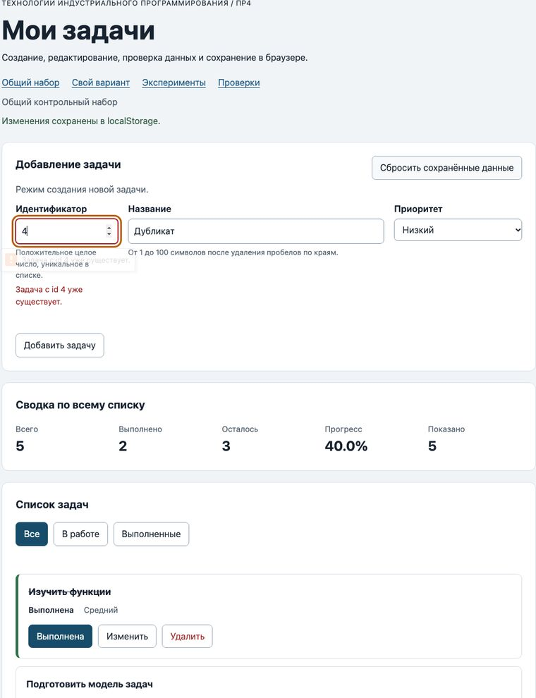

# ПР4. Формы, валидация и localStorage

| | |
|---|---|
| Автор | Мухамбетов Алим, ЭФБО-13-25 |
| Вариант | 1: подготовка учебного проекта, те же шесть задач, что в ПР2–ПР3 |
| Окружение | macOS 26.5.1, Node.js v24.14.1, npm 11.11.0, Git 2.50.1, Chrome 156 |
| Проверено | 01.11.2026: сервис 35/35, модули 27/27, браузер 23/23 |
| Расширение | вариант Б, синхронизация двух вкладок через событие `storage` |



## Запуск

```bash
cd practice-04
npm start                    # http://127.0.0.1:5504/
node tools/serve.mjs 5505    # если порт занят
npm test                     # check:service + check:modules
```

Браузерные проверки: `http://127.0.0.1:5504/checks.html`. Свой вариант:
`index.html?dataset=variant`. `localStorage` привязан к origin, поэтому `127.0.0.1:5504`
и `localhost:5504` — разные хранилища; все прогоны ниже на `127.0.0.1`.

Протоколы в `output/`: `service-checks.txt`, `modules-checks.txt`, `browser-checks.txt`,
`ui-scenarios.txt` (эксперименты, сценарии, свои случаи, две вкладки),
`devtools-debug.txt` (точки останова в `handleFormSubmit`).

## Перенос ПР3

| Файл | Что сделано |
|---|---|
| `data.js` | перенесён без изменений, вариант 1 |
| `task-service.js` | перенесён; внутренний помощник переименован в `replaceTask`, чтобы освободить имя `updateTask`; добавлен `updateTask` |
| `task-selectors.js` | перенесён без изменений |
| `task-view.js` | третья кнопка `edit` с `span.action-label` «Изменить» между статусом и удалением |
| `main.js` | новый из заготовки; из ПР3 взяты `renderApp`, `parseTaskId`, делегирование, фильтры. Отмена удаления ПР3 не переносилась: здесь выбрано другое расширение |

Регрессия после переноса и переименования: `check:service` 35/35.

## Как устроено

| Модуль | Отвечает за | Не делает |
|---|---|---|
| `task-service.js` | операции над массивом, включая `updateTask` | не знает про форму и storage |
| `form-validation.js` | `validateTaskDraft`: строки формы → `{ id, title, priority }` или ошибки по полям | не трогает DOM |
| `task-storage.js` | схема `{ version: 1, tasks }`, JSON, перехват исключений | не трогает DOM и фильтры |
| `task-view.js`, `task-selectors.js` | отображение и выборка, как в ПР3 | не пишут storage |
| `main.js` | состояние, режим формы, события, вызов сохранения | не повторяет правила модели |

Поток успешной операции: `submit`/`click` → `validateTaskDraft` → `addTask`/`updateTask`/
`setTaskCompleted`/`removeTask` → новый `currentTasks` → `saveTasks` → `renderApp`.
`renderApp` storage не читает и не пишет; выбор фильтра и кнопка `edit` ничего не
сохраняют.

**`updateTask`.** Сначала название и приоритет, затем `replaceTask` проверяет `id` и
наличие задачи и строит `{ ...task, title: title.trim(), priority }`. `completed` не
трогается, потому что объект берётся из текущей записи, а не из `createTask`.

**`validateTaskDraft`.**

- `id` в режиме создания: строка формы через `Number`, но пустая строка сразу `NaN`, а не
  ноль. Затем «безопасное положительное целое» и уникальность.
- В режиме редактирования `draft.id` не читается вообще: поле заблокировано и в
  `FormData` не попадает, источник — `editingId`, задача должна существовать.
- `title` — строка, после `trim` от 1 до 100. `priority` — строго один из трёх, `" high "`
  не принимается.
- Все ошибки собираются сразу в объект `errors` только с проблемными полями.

**Хранилище.** Запись проверяется как есть: название с краевыми пробелами, `completed:
"false"`, повтор `id` — и весь список отклоняется, частично ничего не берётся. При
чтении копируются только четыре поля модели, лишние ключи из storage в приложение не
попадают. Каждая ошибка (`getItem`, `JSON.parse`, версия, схема) даёт свой текст.
`saveTasks` не пишет некорректный список, исключение `setItem` превращается в
предупреждение, а изменение остаётся в памяти вкладки.

**Сброс** удаляет только `storageKey`. Если `removeItem` бросил, данные на экране не
меняются: иначе после перезагрузки вернулся бы старый список, а пользователь считал бы
сброс выполненным.

## Задание 1. Эксперименты с формой и JSON

`examples/forms-storage.html`, прогноз записан до запуска.

| № | Прогноз | Факт | Объяснение |
|---:|---|---|---|
| 1 | `submit` не придёт, `valid = false`, сообщение браузера | обработчиков `submit` вызвано 0, `valid=false`, «Please fill out this field.», журнал не изменился | `required` проверяется до события: невалидная форма не отправляется, обработчик не запускается |
| 2 | `submit` придёт, прикладная проверка отклонит | `submit` 1 раз, журнал «прикладная проверка отклонила значение», `valid=false`, `validationMessage` = текст из `setCustomValidity` | для `required` строка из пробелов непустая. После ввода символа `input` вызвал `setCustomValidity("")` → `valid=true` |
| 3 | `defaultPrevented: true`, тип `string`, название без краёв | `true`, `string`, `"Проверить форму"`, `serialized` — строка JSON | `FormData` всегда даёт строки; `trim` выполняет код, а не браузер |
| 4 | `getItem` вернёт строку, `JSON.parse` — объект | `raw` строка, `parsed` `{ title, priority }` | storage хранит только строки |
| 5 | `JSON.parse` бросит `SyntaxError` | «Expected property name or '}' in JSON at position 1» | без `try/catch` запуск приложения упал бы на чтении |

Итог: HTML-ограничения проверяют форму поля, прикладное правило — смысл значения
(пробелы, занятый `id`), а ошибка разбора относится к сохранённой строке и
обрабатывается при чтении, а не в форме.

## Общий сценарий (6.8)

Реальные нажатия мыши и ввод текста в Chrome через CDP. Приоритет выбирался установкой
`value` с событиями `input`/`change`, потому что список `select` в headless не
открывается.

| Шаг | Действие | Ожидание | Факт | Итог |
|---:|---|---|---|---|
| 0 | сброс | `[1,4,7,10]` 4/2/2/50.0%, ключа нет | так же, `storage=нет ключа` | совпало |
| 1 | добавить 20, high | `[1,4,7,10,20]` 5/2/3/40.0% | так же, в storage `[1,4,7,10,20]` | совпало |
| 2 | повторный `id 4` | ошибка у id, без изменений | «Задача с id 4 уже существует.» у поля, строка в storage та же (`true`) | совпало |
| 3 | изменить 4 → «Подготовить форму задач», low | те же id, 40.0%, 4 не выполнена | в storage `{"id":4,…,"completed":false,"priority":"low"}` | совпало |
| 4 | выполнить 7 | 5/3/2/60.0% | 5/3/2/60.0% | совпало |
| 5 | удалить 1 | `[4,7,10,20]` 4/2/2/50.0% | так же | совпало |
| 6 | перезагрузка | то же, сообщение о восстановлении | «Данные восстановлены из localStorage.» | совпало |
| 7 | сброс | `[1,4,7,10]`, ключа нет | так же, `storage=нет ключа` | совпало |

`{broken-json` в ключ `tip-js-practice-04:demo` и перезагрузка: исходный набор и
предупреждение «Сохранённые данные повреждены: строка не является JSON. Показан исходный
набор.»; после сброса ключа нет.

**Клавиатура и фокус.** `Enter` в поле названия отправляет форму (задача 30 добавлена).
После создания фокус в поле id, после `edit` — в поле названия, после `toggle` — на той
же кнопке, после удаления — на активном фильтре.

## Отладка в DevTools

Точки останова в `src/main.js`: 195 (`const checked = validateTaskDraft(…)`) и 212
(`currentTasks = result.tasks`). Протокол: `output/devtools-debug.txt`.

| Остановка | Значения |
|---|---|
| 195, добавление 21 | `draft = { id: "21", title: "  Отладить форму  ", priority: "medium" }`, `typeof draft.id = "string"`, `editingId = null` |
| Step over → 196 | `checked = { ok: true, value: { id: 21, title: "Отладить форму", priority: "medium" } }` |
| 212 | `result.ok = true`, id `[1,4,7,10,21]`, новая запись `completed: false`, `result.tasks === currentTasks` → `false`; storage ещё `null` |
| после Resume | storage `{"version":1,"tasks":[…,{"id":21,"title":"Отладить форму",…}]}` |
| 195, повтор `id 4` | `draft = { id: "4", title: "Дубликат", … }` |
| Step over → 196 | `checked = { ok: false, errors: { id: "Задача с id 4 уже существует." } }` |
| Resume | до строки 212 не дошло, storage тот же, у поля текст ошибки и `aria-invalid="true"` |

## Проверки

| Набор | Команда | Итог |
|---|---|---|
| сервис ПР2 | `npm run check:service` | **35 / 0** |
| новые модули | `npm run check:modules` | **27 / 0** |
| браузер | `checks.html` | **23 / 0** |

Готовые проверки не менялись.

## Собственные случаи

| Случай | Исходное состояние и действие | Ожидание | Факт | Итог |
|---|---|---|---|---|
| Граница формы: длина | ввести `"  " + 100 × "я" + "  "` (104 символа) | `maxlength` обрежет ввод до 100, сохранится строка после `trim` | в поле 100, сохранено название длиной 98 | пройдено, см. ниже |
| Граница формы: `1e1` | `id = "1e1"` | `type="number"` пропустит, `Number` даст 10 → занят | «Задача с id 10 уже существует.» | пройдено |
| Нативные границы id | `0`, затем `1.5` | `submit` не придёт, данных нет | «Value must be greater than or equal to 1.», «…nearest valid values are 1 and 2.», ключа нет | пройдено |
| Перезагрузка во время редактирования | начать править 4, выполнить 10, перезагрузить | статус 10 восстановлен, правка 4 потеряна, форма в создании | 4/1/3/25.0%, «Добавить задачу» | пройдено |
| Удалить редактируемую | `edit` у 10, затем удалить 10 | форма вернётся в создание | `[1,4,7]`, «Добавить задачу» | пройдено |
| `setItem` бросает | подменить `Storage.prototype.setItem` на `QuotaExceededError`, выполнить 4 | экран изменён, предупреждение; после перезагрузки изменения нет | 75.0% и «Не удалось сохранить… после перезагрузки изменения пропадут.»; после перезагрузки 50.0% | пройдено |
| `getItem` бросает при запуске | подмена до загрузки страницы | исходный набор и текст ошибки, страница работает | «Не удалось прочитать localStorage: доступ запрещён. Показан исходный набор.» | пройдено |
| Повтор id в storage | `{ version: 1, tasks: [id 1, id 1] }` | вся запись отклонена | «Сохранённые задачи не прошли проверку схемы.» | пройдено |
| Чужая версия | `{ version: 2, tasks: [] }` | fallback | «Неизвестная версия сохранённых данных: 2.» | пройдено |

Про длину: `maxlength` считает и краевые пробелы, а правило модели — длину после
`trim`. Поэтому через форму название из 100 значимых символов с пробелами по краям ввести
нельзя, браузер обрежет хвост. Это ограничение интерфейса, данные остаются корректными.

## Индивидуальный вариант

`index.html?dataset=variant`, ключ `tip-js-practice-04:variant`.

| Этап | Ожидание | Факт | Итог |
|---|---|---|---|
| сброс | `[11,23,37,41,58,64]` 6/0/6/0.0% | так же, «Индивидуальный вариант: 1» | совпало |
| добавить 75 «Сверить оформление с требованиями кафедры», medium | 7/0/7/0.0% | 7/0/7/0.0% | совпало |
| изменить 23 → «Отобрать пять ключевых источников», high | статус не меняется | `{"id":23,…,"completed":false,"priority":"high"}` | совпало |
| удалить 37 | `[11,23,41,58,64,75]` 6/0/6/**0.0%** | так же | совпало |
| перезагрузка | то же из storage | строка storage совпала до и после | совпало |
| общий набор | не изменился | `[1,4,7,10]` 50.0%, ключа demo нет | совпало |
| вариант, сброс | шесть исходных | `[11,23,37,41,58,64]`, ключа нет | совпало |

## Расширение Б: две вкладки

Правила:

- `storage` приходит только в другие вкладки того же origin. Вкладка, которая сделала
  запись, отрисовалась сама и событие не получает, поэтому локальная отрисовка им не
  заменяется.
- Учитывается только свой ключ (`key === storageKey`) или `key === null`
  (`localStorage.clear()` в другой вкладке).
- Новое значение читается через тот же `loadTasks`: корректная запись заменяет список,
  удалённый ключ означает сброс.
- Некорректные данные из другой вкладки не применяются: текущий список остаётся,
  показывается предупреждение. Перезаписывать storage в ответ нельзя, иначе вкладки
  начали бы спорить.
- Если редактируемая задача исчезла, форма возвращается в создание с сообщением.
  Фильтр каждой вкладки свой.

| Проверка | Действие во вкладке A | Ожидание во вкладке B | Факт в B | Итог |
|---|---|---|---|---|
| Сохранение | добавить 30 | `[1,4,7,10,30]` без действий в B | так же, «Список обновлён из другой вкладки.» | пройдено |
| Удаление редактируемой | B правит 30, A удаляет 30 | форма B в режиме создания | «Редактируемая задача удалена в другой вкладке.», `[1,4,7,10]` | пройдено |
| Статус | выполнить 4 | 75.0%, старое сообщение формы убрано | 4/3/1/75.0%, сообщение формы пустое | пройдено |
| Фильтр не пишет | B выбирает «В работе» | A и storage без изменений | A 75.0%, storage прежний | пройдено |
| Сброс | сброс | исходный набор, фильтр B остаётся | «В другой вкладке выполнен сброс…», 4/2/2/50.0%, видны `[4,7]` | пройдено |
| Неверные данные | записать `{"version":1,"tasks":"сломано"}` | список B не меняется | предупреждение, B оставила 4/3/1/75.0% | пройдено |
| Чужой ключ | изменить вариант | B (demo) не реагирует | без изменений | пройдено |

## Вывод

В ПР3 данные жили до перезагрузки, здесь каждая успешная операция записывается, а при
запуске запись читается обратно. Главное: прочитанная строка — внешний ввод, как и поле
формы. `JSON.parse` подтверждает только синтаксис, поэтому версия и каждая задача
проверяются, и при любой ошибке используется исходный набор целиком. Форма проверяется
дважды: браузер ловит структуру (`required`, `min`, `step`), `validateTaskDraft` — правила
модели, а сервис всё равно проверяет данные сам. Неочевидное наблюдение — `maxlength`
считает пробелы, которые модель потом отрезает, а `type="number"` пропускает `1e1`.
