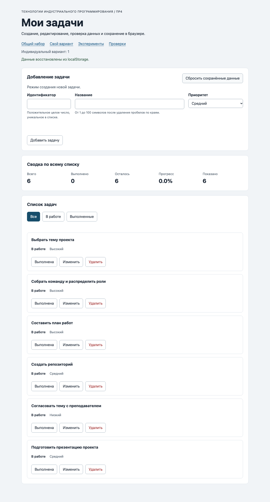

# Практическая работа № 4. Формы, валидация и локальное хранение данных

## Данные работы

| Параметр | Значение |
|---|---|
| Студент | Мухамбетов Алим |
| Группа | ЭФБО-13-25 |
| Вариант из ПР2–ПР3 | 1, подготовка учебного проекта |
| ОС | macOS 26.5.1, arm64 |
| Node.js | v24.14.1 |
| Браузер | Google Chrome 155 |

## Запуск

Из папки `practice-04`:

```bash
npm test
npm start
```

После `npm start` открыть:

- приложение: http://127.0.0.1:5504/
- свой вариант: http://127.0.0.1:5504/index.html?dataset=variant
- эксперименты: http://127.0.0.1:5504/examples/forms-storage.html
- проверки: http://127.0.0.1:5504/checks.html

## Перенос результата ПР3

| Файл | Что перенесено или изменено |
|---|---|
| `data.js` | Скопирован из ПР3 без изменений, вариант 1 и те же шесть задач |
| `task-service.js` | Скопирован из ПР3, добавлена `updateTask(tasks, id, title, priority)` |
| `task-selectors.js` | Оставлена только `getVisibleTasks`, фильтр по приоритету из расширения ПР3 сюда не переносил, на странице ПР4 его нет |
| `task-view.js` | Скопирован из ПР3, в карточку добавлена третья кнопка `edit` с подписью «Изменить» |

После переноса `npm run check:service` прошёл 35 из 35, исправлять старый код не пришлось.

## Эксперименты с формой и хранилищем

| № | Прогноз | Результат | Объяснение |
|---:|---|---|---|
| 1. Пустое обязательное поле | Событие submit не придёт | Журнал остался «Действия ещё не выполнялись», `validity.valueMissing` равно `true`, браузер показал «Please fill out this field.» | Атрибут `required` проверяется до submit, поэтому обработчик формы даже не вызывается |
| 2. Название из пробелов | Браузер пропустит | submit пришёл, прикладная проверка написала «Название не должно состоять только из пробелов.» | Для `required` строка из пробелов не пустая. Пробелы отсекает уже `trim()` в коде |
| 3. Типы значений `FormData` | Все значения строки | `typeof FormData title: string`, для поля `type="number"` со значением 20 тоже пришла строка `"20"` | `FormData` всегда отдаёт строки, поэтому id в `validateTaskDraft` переводится в число вручную |
| 4. Строка в `localStorage` и JSON | Сохранится строка | `typeof localStorage value: string`, в хранилище `{"title":"Форма","priority":"high"}`, «Прочитать» вернул тот же объект | `localStorage` хранит только строки, объект надо сериализовать через `JSON.stringify` и читать через `JSON.parse` |
| 5. Повреждённый JSON | `JSON.parse` выбросит ошибку | «JSON.parse завершился ошибкой: Expected property name or '}' in JSON at position 1» | Без `try/catch` такое значение уронило бы запуск приложения, поэтому чтение в `loadTasks` обёрнуто |

## Организация кода

- `task-service.js` меняет массив задач и ничего не знает про DOM и хранилище. Новая `updateTask` меняет только `title` и `priority`, `completed` остаётся прежним.
- `form-validation.js` проверяет черновик формы: переводит id в число, обрезает пробелы в названии, проверяет приоритет. В режиме редактирования id берётся из `editingId`, а не из поля. Возвращает либо значение, либо объект ошибок по полям.
- `task-storage.js` читает, сохраняет и удаляет запись `{ version, tasks }`. Все исключения хранилища ловятся здесь и превращаются в `{ ok: false, error }`.
- `task-view.js` только строит DOM карточек и сводки.
- `main.js` связывает всё вместе: обработчики формы, карточек, фильтров, сброса и события `storage`.

Функции хранения получают `storage` аргументом, поэтому их можно проверить в Node.js на объекте `MemoryStorage` или на объекте, который бросает ошибку, без настоящего браузера. Данные из JSON проверяются через `isValidTaskList`, потому что запись мог изменить кто угодно: другая версия приложения, другая вкладка или человек в DevTools. Без проверки строка `"нет"` в поле `completed` дошла бы до сводки и сломала подсчёт.

## Проверка формы

| Сценарий | Ожидаемый результат | Фактический результат | Итог |
|---|---|---|---|
| Добавление корректной задачи | Задача в списке и в storage | `20` добавлена, список `[1, 4, 7, 10, 20]`, в ключе те же id | Да |
| Повторяющийся id | Отказ без изменения списка | Ошибка у поля id «Задача с id 4 уже есть», `aria-invalid="true"`, запись в storage не изменилась | Да |
| Пустое название | Отказ | Браузер не отправил форму, `valueMissing: true`, список прежний | Да |
| Название из пробелов | Отказ прикладной проверки | Ошибка «Введите название» у поля названия | Да |
| Название длиной 100 | Успех | Задача `31` добавлена, длина названия 100 | Да |
| Название длиной 101 | Отказ | Ошибка «Название длиннее 100 символов». Строку подставил через `value` в консоли, руками больше 100 символов не набрать из за `maxlength` | Да |
| Редактирование title и priority | Меняется одна задача, статус сохраняется | Задача 4 стала `Подготовить форму задач`, `low`, `completed: false` | Да |
| Отмена редактирования | Возврат к пустой форме создания | Поля пустые, приоритет `medium`, кнопка «Добавить задачу», кнопка отмены скрыта | Да |

## Общий сценарий

Перед началом нажал «Сбросить сохранённые данные».

| Шаг | Действие | Видимые id | Всего | Выполнено | Осталось | Прогресс | Состояние storage |
|---:|---|---|---:|---:|---:|---:|---|
| 0 | Исходный запуск после сброса | `[1, 4, 7, 10]` | 4 | 2 | 2 | `50.0%` | ключа нет |
| 1 | Добавление `id = 20` | `[1, 4, 7, 10, 20]` | 5 | 2 | 3 | `40.0%` | `[1, 4, 7, 10, 20]` |
| 2 | Отказ для повторного `id = 4` | `[1, 4, 7, 10, 20]` | 5 | 2 | 3 | `40.0%` | запись не изменилась |
| 3 | Редактирование `id = 4` | `[1, 4, 7, 10, 20]` | 5 | 2 | 3 | `40.0%` | у задачи 4 `low`, `completed: false` |
| 4 | Переключение `id = 7` | `[1, 4, 7, 10, 20]` | 5 | 3 | 2 | `60.0%` | `[1, 4, 7, 10, 20]` |
| 5 | Удаление `id = 1` | `[4, 7, 10, 20]` | 4 | 2 | 2 | `50.0%` | `[4, 7, 10, 20]` |
| 6 | Перезагрузка страницы | `[4, 7, 10, 20]` | 4 | 2 | 2 | `50.0%` | «Данные восстановлены из localStorage.» |
| 7 | Сброс данных | `[1, 4, 7, 10]` | 4 | 2 | 2 | `50.0%` | ключа `tip-js-practice-04:demo` нет |

Все значения совпали с таблицей методички. Потом записал в ключ строку `{broken-json` и обновил страницу: открылся исходный набор `[1, 4, 7, 10]`, в строке состояния предупреждение «Сохранённые данные повреждены, показан исходный набор.» После сброса ключ снова пропал.

## Проверка восстановления и ошибок

| Случай | Ожидание | Фактический результат | Итог |
|---|---|---|---|
| Записи нет | Используется независимая копия исходного набора | `source: "initial"`, проверки 16 и 27: изменение результата не трогает `demoTasks` | Да |
| Корректная запись | Данные восстанавливаются после перезагрузки | Шаг 6 общего сценария, `[4, 7, 10, 20]` | Да |
| Повреждённый JSON | Исходный набор и предупреждение | `{broken-json` даёт исходный набор и класс `is-warning` | Да |
| Неверная версия или схема | Исходный набор и предупреждение | `version: 999` и `completed: "нет"` отклоняются, проверки 19, 20 и браузерная проверка схемы | Да |
| Сброс | Удаляется только ключ текущего набора | Проверка 25: соседний ключ остался. После сброса общего набора ключ варианта не тронут | Да |
| Общий и индивидуальный наборы | Изменения не смешиваются | После изменений варианта общий набор открылся исходным, ключа `demo` нет | Да |

## Индивидуальный вариант

Исходные задачи: 11 «Выбрать тему проекта», 23 «Собрать команду», 37 «Найти источники по теме», 41 «Составить план работ», 58 «Создать репозиторий», 64 «Согласовать тему с преподавателем». Все не выполнены.

Добавил `75` «Подготовить презентацию проекта» (`medium`), задачу `23` переименовал в «Собрать команду и распределить роли» с приоритетом `high`.

| Этап | Всего | Выполнено | Осталось | Прогресс | Видимые id |
|---|---:|---:|---:|---:|---|
| Исходный набор | 6 | 0 | 6 | `0.0%` | `[11, 23, 37, 41, 58, 64]` |
| После добавления `75` | 7 | 0 | 7 | `0.0%` | `[11, 23, 37, 41, 58, 64, 75]` |
| После редактирования `23` | 7 | 0 | 7 | `0.0%` | `[11, 23, 37, 41, 58, 64, 75]` |
| После удаления `37` | 6 | 0 | 6 | `0.0%` | `[11, 23, 41, 58, 64, 75]` |
| После перезагрузки | 6 | 0 | 6 | `0.0%` | `[11, 23, 41, 58, 64, 75]` |
| После сброса | 6 | 0 | 6 | `0.0%` | `[11, 23, 37, 41, 58, 64]` |

Итог `0.0%` совпадает с таблицей для варианта 1. У задачи 23 после редактирования `completed: false`, статус не изменился. Общий набор между этими шагами открылся без изменений.

## Протокол проверок сервиса

```text
OK: 01. Создание задачи с явным приоритетом
OK: 02. Приоритет по умолчанию
OK: 03. Удаление краевых пробелов без изменения внутренних
OK: 04. Граничные длины названия и положительный безопасный id
OK: 05. Некорректные названия при создании
OK: 06. Некорректные идентификаторы при создании
OK: 07. Все допустимые приоритеты и отклонение недопустимых
OK: 08. Каждый вызов createTask возвращает новый объект
OK: 09. Поиск по id, а не по индексу
OK: 10. Отсутствующая задача и пустой массив при поиске
OK: 11. Поиск не преобразует строковый id в число
OK: 12. Получение невыполненных задач
OK: 13. Пустой список, все выполнены и все не выполнены
OK: 14. Названия в исходном порядке и пустой список
OK: 15. Сводка по общему набору
OK: 16. Сводка по пустому списку
OK: 17. Сводка: ничего не выполнено и выполнено всё
OK: 18. Процент остаётся числом без предварительного округления
OK: 19. Добавление в конец без изменения входного массива
OK: 20. Добавление в пустой список с приоритетом по умолчанию
OK: 21. Повторяющийся id отклоняется
OK: 22. Добавление не обходит проверки createTask
OK: 23. Изменение completed в обе стороны
OK: 24. completed принимает только boolean
OK: 25. Некорректный или отсутствующий id при изменении статуса
OK: 26. Повторная установка статуса создаёт новый результат
OK: 27. Переименование сохраняет остальные поля
OK: 28. Проверки названия при переименовании
OK: 29. Некорректный или отсутствующий id при переименовании
OK: 30. Удаление по id с сохранением порядка
OK: 31. Удаление единственной записи
OK: 32. Некорректный, отсутствующий id и удаление из пустого списка
OK: 33. Входные объекты не изменяются ни одной операцией
OK: 34. Общий сценарий и все промежуточные сводки
OK: 35. Работа с другим набором, без зависимости от demoTasks

Проверок пройдено: 35; не пройдено: 0.
```

## Протокол проверок новых модулей

```text
OK: 01. updateTask изменяет название и приоритет выбранной задачи
OK: 02. updateTask нормализует название и сохраняет completed
OK: 03. updateTask не изменяет входной массив и объекты
OK: 04. updateTask отклоняет некорректный и отсутствующий id
OK: 05. updateTask отклоняет некорректные название и приоритет
OK: 06. Валидация создания нормализует поля
OK: 07. Валидация отклоняет некорректные id
OK: 08. Валидация отклоняет повторяющийся id при создании
OK: 09. Валидация проверяет название после trim
OK: 10. Валидация принимает только три приоритета
OK: 11. В режиме редактирования используется editingId
OK: 12. Редактирование отсутствующей задачи отклоняется
OK: 13. Валидация не изменяет draft и список
OK: 14. Проверка схемы принимает корректный список
OK: 15. Проверка схемы отклоняет неверную структуру
OK: 16. Отсутствующая запись возвращает независимую копию исходных данных
OK: 17. Корректная запись восстанавливается из хранилища
OK: 18. Повреждённый JSON приводит к безопасному fallback
OK: 19. Неизвестная версия приводит к безопасному fallback
OK: 20. Некорректные задачи из JSON не принимаются
OK: 21. Ошибка getItem перехватывается
OK: 22. Сохранение записывает версию и задачи
OK: 23. Некорректный список не записывается
OK: 24. Ошибка setItem перехватывается
OK: 25. Удаляется только переданный ключ
OK: 26. Ошибка removeItem перехватывается
OK: 27. Результат загрузки не разделяет объекты с fallback

Проверок пройдено: 27; не пройдено: 0.
```

## Протокол браузерных проверок

```text
OK: Фильтры ПР3 сохраняют порядок и не изменяют вход
OK: Карточка содержит toggle, edit и delete
OK: Название задачи выводится как текст
OK: Повторная отрисовка списка не накапливает карточки
OK: Сводка использует полный список и отдельный visibleCount
OK: Пустые состояния различают список и фильтр
OK: Приложение запускается с исходным набором
OK: Корректная форма добавляет задачу и сохраняет данные
OK: Повторяющийся id отклоняется без записи
OK: Название из пробелов отклоняется прикладной проверкой
OK: Нативные ограничения не пропускают пустую форму
OK: Кнопка edit заполняет форму и блокирует id
OK: Редактирование меняет title и priority, сохраняя completed
OK: Отмена редактирования возвращает режим создания
OK: Успешная отправка очищает ошибки и форму
OK: Изменение статуса сохраняется
OK: Удаление сохраняется
OK: Фильтр не записывается, но сохраняется после изменения данных
OK: Перезагрузка восстанавливает сохранённые задачи
OK: Сброс удаляет ключ и восстанавливает исходный набор
OK: Повреждённый JSON не ломает запуск
OK: Некорректная схема из storage заменяется исходным набором
OK: Общий и индивидуальный наборы используют разные ключи
```

## Собственные проверки

| № | Исходное состояние и действия | Ожидаемый результат | Фактический результат | Итог |
|---:|---|---|---|---|
| 1 | Общий набор. Нажать «Изменить» у задачи 7, потом «Удалить» у неё же | Задача удалена, форма вернулась в режим создания | Список `[1, 4, 10]`, поля формы пустые, кнопка «Добавить задачу» | Да |
| 2 | Изменить название задачи 4, отметить её выполненной, включить фильтр «Выполненные», перезагрузить | Название и статус восстановлены, фильтр снова «Все», так как он не сохраняется | `4/3/1/75.0%`, задача 4 «Новый текст» выполнена, активный фильтр `all` | Да |
| 3 | Записать в ключ корректный JSON, где две задачи с `id: 5`, перезагрузить | Запись отклонена, исходный набор и предупреждение | `[1, 4, 7, 10]`, «Сохранённые задачи имеют неверный формат, показан исходный набор.» | Да |
| 4 | Подменить `Storage.prototype.setItem` на функцию, которая бросает `QuotaExceededError`, отметить задачу 4 | Страница не падает, пользователь видит, что сохранить не удалось | Задача отмечена на экране, сообщение «Не удалось сохранить изменения в localStorage.», после перезагрузки исходный набор, так как запись не прошла | Да |

## Отладка и клавиатура

Значения в `handleFormSubmit` при добавлении задачи 20:

- сырой черновик из `FormData`: `{ id: "20", title: "Изучить localStorage", priority: "high" }`, id строкой;
- результат `validateTaskDraft`: `{ ok: true, value: { id: 20, title: "Изучить localStorage", priority: "high" } }`;
- результат `addTask`: `ok: true`, в `tasks` 5 задач;
- строка в хранилище:

```text
{"version":1,"tasks":[{"id":1,"title":"Изучить функции","completed":true,"priority":"medium"},{"id":4,"title":"Подготовить модель задач","completed":false,"priority":"high"},{"id":7,"title":"Проверить методы массивов","completed":false,"priority":"low"},{"id":10,"title":"Оформить README","completed":true,"priority":"medium"},{"id":20,"title":"Изучить localStorage","completed":false,"priority":"high"}]}
```

При повторном id 4 `validateTaskDraft` вернул `{ ok: false, errors: { id: "Задача с id 4 уже есть" } }`, до `addTask` и `saveTasks` выполнение не дошло.

Клавиатура: Enter на кнопке «Изменить» открывает режим редактирования, фокус переходит в поле названия. Space на кнопке «Выполнена» меняет статус, после перерисовки фокус остаётся на той же кнопке той же задачи (`restoreTaskFocus`). Enter на «Отменить редактирование» возвращает пустую форму создания.

## Вид приложения



## Дополнительное задание

Выбран вариант Б, синхронизация двух вкладок.

`main.js` слушает событие `storage`. Оно приходит только в другие вкладки, вкладка, которая сама сделала запись, его не получает и обновляется обычной отрисовкой. При событии для своего ключа (или `key === null` после `localStorage.clear()`) список заново читается через `loadTasks`, поэтому повреждённые данные из другой вкладки проходят ту же проверку, что и при запуске. Если редактируемую задачу удалили в другой вкладке, форма возвращается в режим создания. Фильтр вкладки не сбрасывается.

Проверял в двух вкладках с общим набором:

| № | Действия | Результат во второй вкладке | Итог |
|---:|---|---|---|
| 1 | Во второй вкладке фильтр «В работе», в первой добавить задачу 20 | Без перезагрузки показано `[4, 7, 20]`, сводка `5/2/3/40.0%`, фильтр остался «В работе», статус «Список обновлён из другой вкладки.» | Да |
| 2 | Во второй вкладке «Изменить» у задачи 7, в первой удалить 7 | Задачи 7 нет, форма вернулась в режим создания | Да |
| 3 | В первой вкладке сброс | Исходный набор, статус «В другой вкладке данные сброшены, показан исходный набор.» | Да |
| 4 | В первой вкладке записать в ключ `{broken-json` | Исходный набор и предупреждение «Сохранённые данные повреждены» | Да |
| 5 | В первой вкладке записать что-то в ключ варианта | Вторая вкладка с общим набором ничего не меняет | Да |

Если во второй вкладке открыто редактирование задачи, а в первой у неё поменяли статус, форма остаётся открытой. При сохранении `updateTask` берёт уже обновлённый список, поэтому новый статус не теряется.

## Вывод

Приложение умеет добавлять и редактировать задачи через форму, сохраняет все изменения в `localStorage` и восстанавливает их после перезагрузки. Все три набора проверок прошли: 35, 27 и 23. Отдельно поправил одну мелочь: после ошибки в форме в строке операции оставалось старое сообщение «Задача 20 добавлена», теперь оно очищается.

Проверки идут в три слоя. Нативная проверка HTML (`required`, `min`, `maxlength`) ловит пустые поля ещё до submit, но пропускает строку из пробелов и не знает про уникальность id. Прикладная валидация в `validateTaskDraft` проверяет смысл: trim, повтор id, допустимые приоритеты. Проверка после чтения из хранилища нужна потому, что в `localStorage` может лежать что угодно, и приложение не должно доверять даже своим старым записям.
