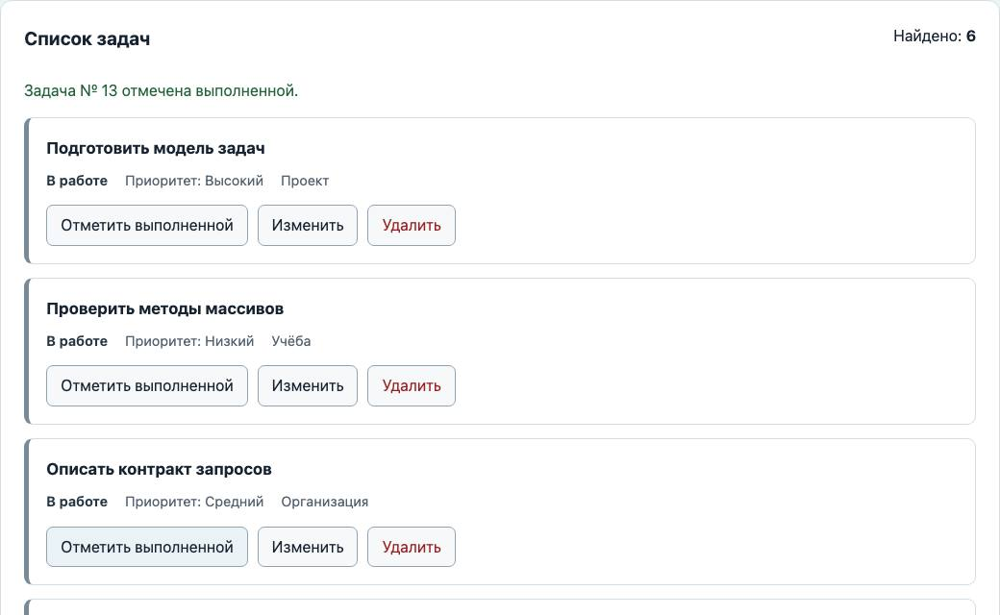

# ПР6. Интерфейс задач поверх HTTP API

| | |
|---|---|
| Автор | Мухамбетов Алим, ЭФБО-13-25 |
| Вариант | 1: `{ completed: false }`, только невыполненные задачи |
| Окружение | macOS 26.5.1, Node.js v24.14.1, npm 11.11.0, Chrome 156 |
| Проверено | 01.11.2026: API 23/23, модули 33/33, интеграция 14/14, свои 11/11, браузер 14/14 |
| Расширение | задание 14.2, поиск с debounce 400 мс и отменой предыдущего запроса |



## Цель и результат

Цель: заменить `localStorage` из ПР4 настоящим HTTP API. Интерфейс читает и меняет
задачи только запросами, показывает состояния загрузки и не даёт устаревшему ответу
затереть свежий.

Результат: работают создание, редактирование, смена статуса, удаление и сброс. После
каждой мутации список запрашивается заново. Остановленный API даёт состояние `error` и
кнопку повтора, а быстрые фильтры не смешивают ответы.

## Запуск

```bash
cd practice-06
npm start          # API http://127.0.0.1:5505/api и приложение http://127.0.0.1:5506/
npm test           # API, модули, интеграция и собственные проверки (81 проверка)
```

| Адрес | Что открывает |
|---|---|
| `http://127.0.0.1:5506/` | приложение без фильтра |
| `http://127.0.0.1:5506/?dataset=variant` | приложение со стартовым фильтром варианта 1 |
| `http://127.0.0.1:5506/checks.html` | 14 браузерных проверок (API должен быть на 5505) |
| `http://127.0.0.1:5506/?api=http://127.0.0.1:5515/api` | приложение с API на другом порту |

Другие порты: `node tools/start.mjs 5515 5516`. Протоколы лежат в `output/`, файлы `api/`
не менялись.

## Как устроено

Слои зависят только сверху вниз. Контроллер не знает про DOM, представление не знает про
HTTP.

```
dom-app.js ──события──▶ app-controller.js ──▶ task-api.js ──▶ api-client.js ──▶ fetch
     ▲                        │                    │
     └──── view.set*() ◀──────┘           проверка схемы ответа
```

| Модуль | Ответственность |
|---|---|
| `src/api-client.js` | URL и query, методы GET/POST/PATCH/DELETE, JSON-тело, тайм-аут и отмена, вид ошибки (`http`, `network`, `timeout`, `aborted`, `invalid-response`) |
| `src/task-api.js` | операции над задачами, проверка фильтров до запроса, проверка схемы каждого ответа |
| `src/form-validation.js` | чистая функция: черновик формы превращается в `{ valid, value, errors }` |
| `src/task-view.js` | карточка `li.task-card` и перерисовка списка через `replaceChildren` |
| `src/app-controller.js` | состояние, загрузка с отменой, общая схема мутации |
| `src/debounce.js` | расширение: откладывает вызов до паузы ввода |
| `src/dom-app.js`, `src/main.js` | даны готовыми. В `dom-app.js` добавлено только подключение debounce к полю поиска |

### HTTP-клиент

Основа перенесена из ПР5. Добавлены метод и тело запроса.

| Правило | Как сделано |
|---|---|
| Допустимые методы | `GET`, `POST`, `PATCH`, `DELETE`. Регистр приводится (`"patch"` → `PATCH`), `PUT` даёт `TypeError` |
| Тело | `JSON.stringify(body)` и `Content-Type: application/json`, только если тело передано |
| `GET` с телом | `TypeError` до отправки: такой запрос `fetch` всё равно отклонил бы |
| Порядок проверки ответа | `response.ok` → статус 204 → `Content-Type` → `response.json()` |
| Тайм-аут | 3000 мс по умолчанию, `AbortSignal.timeout` объединяется с внешним сигналом через `AbortSignal.any` |
| Вид отказа | определяется по сигналу: совпал `reason` тайм-аута → `timeout`, иначе сигнал прерван → `aborted`, иначе `network` |

Ответ 204 возвращается как `null` до чтения тела. Ошибка HTTP разбирается раньше
`Content-Type`, поэтому HTML от прокси с кодом 502 останется ошибкой `http`, а не станет
`invalid-response`.

### Доменный API

| Метод | Запрос | Что проверяется в ответе |
|---|---|---|
| `getTasks(filters, { signal })` | `GET /tasks?…` | массив задач без повторов id, `meta.total`, `meta.filters` |
| `getTaskById(id, { signal })` | `GET /tasks/:id` | `{ data: task }` |
| `getCategories({ signal })` | `GET /categories` | массив категорий |
| `loadInitialData(filters, { signal })` | оба запроса через `Promise.all` | как у двух методов выше |
| `createTask(draft, { signal })` | `POST /tasks` | созданная задача с серверным id |
| `updateTask(id, changes, { signal })` | `PATCH /tasks/:id` | изменённая задача |
| `setTaskCompleted(id, value, { signal })` | `PATCH /tasks/:id`, тело `{ completed }` | изменённая задача |
| `deleteTask(id, { signal })` | `DELETE /tasks/:id` | ровно `null`, то есть 204. Любое тело означает `invalid-response` |
| `resetDemoData({ signal })` | `POST /debug/reset` без тела | `{ reset: true, total }` |

Неизвестный фильтр, неверный тип или id ≤ 0 дают `TypeError` до сети. Последний аргумент
передаёт клиенту только `signal`: метод и тело задаёт сам доменный API, снаружи их не
подменить.

### Состояния интерфейса

```
            start / applyFilters / refresh / после мутации
                              │
                              ▼
                          loading ──── ответ устарел или aborted ──▶ (ничего)
                     ┌───────┼────────┐
               задачи есть  пусто   ошибка
                     ▼       ▼        ▼
                   ready   empty    error + «Повторить загрузку»
```

`empty` означает, что сервер ответил успешно и задач по условиям нет: счётчик равен 0.
`error` означает, что данных нет вовсе: список скрыт, видна кнопка повтора. Если категории
ещё ни разу не пришли, повтор снова вызывает `loadInitialData`, иначе только `getTasks`.

### Мутации

Все пять мутаций идут через внутреннюю `runMutation(operation, successMessage)`:

1. Если мутация уже идёт, повторный вызов игнорируется: двойной щелчок не создаст дубль.
2. `view.setMutationPending(true)` блокирует кнопки формы, сброса и карточек.
3. После успешного запроса выводится `notify(…, "success")` и список запрашивается заново
   с текущими фильтрами.
4. Ошибка выводится как `notify(messageForError(error), "error")`. При 404 список
   обновляется, а форма выходит из режима редактирования: запись удалили в другой вкладке.
5. В `finally` блокировка снимается в любом случае.

Редактирование отправляет только `title`, `priority` и `categoryId`, без `completed`.
Поэтому сервер сохраняет текущий статус задачи (сценарий 6).

### Защита от устаревшего ответа

Каждая загрузка делает две вещи:

- `state.loadController?.abort()`: предыдущий запрос рвётся, сервер не тратит на него
  время, а браузер показывает его как `canceled`;
- `seq = ++state.loadSeq`: после каждого `await` результат применяется, только если
  `seq === state.loadSeq`.

Одной отмены мало. Ответ мог уже прийти и стоять в очереди микрозадач, когда пользователь
сменил фильтр, и тогда `abort()` его не остановит. Номер загрузки отсекает и этот случай.
Ошибка `aborted` пользователю не показывается: её вызвал сам код, а новая загрузка уже
идёт. `destroy()` отменяет активную загрузку и запрещает любые изменения представления.

## Вариант 1

`variantNumber = 1`, стартовый фильтр `{ completed: false }`, адрес `?dataset=variant`.

| Шаг | Ожидание | Факт |
|---|---|---|
| Открыть `?dataset=variant` | в фильтре «Не выполнены», только невыполненные | фильтр `false`, id `[4,7,13,19,22,28,34]`, всего 7 |
| Отметить задачу № 13 выполненной | `PATCH /tasks/13`, затем GET с тем же фильтром | `PATCH /tasks/13`, `GET /tasks?completed=false` |
| Результат | задача уходит из выборки, счётчик 6 | id `[4,7,19,22,28,34]`, всего 6 |

Задача исчезает не из-за локального удаления из массива. Сервер вернул новый список, и в
нём её больше нет. Тот же сценарий в Node без браузера проверяет собственная проверка В1.

## Проверки

### Node.js (`npm test`, протокол `output/node-checks.txt`)

| Набор | Команда | Итог |
|---|---|---|
| Учебный API | `npm run check:api` | **23/23** |
| Модули | `npm run check:modules` | **33/33** |
| Интеграция с настоящим сервером | `npm run check:integration` | **14/14** |
| Собственные | `npm run check:own` | **11/11** |

### Браузер (`checks.html`, протокол `output/browser-checks.txt`)

Итог **14/14**: страница открыта в Chrome 156 без окна, итог прочитан из `#check-summary`.

Замечание к самой проверке. В тесте «Корректная форма создаёт задачу с серверным id»
условие ожидания было `waitFor(() => requireNode(doc, '[data-task-id="35"]'))`.
`requireNode` бросает исключение, если узла нет, а `waitFor` не перехватывает исключения
условия. Поэтому проверка падала на первом же синхронном опросе, сразу после
`requestSubmit()`, когда POST ещё в пути. Заодно ломалась следующая проверка: опоздавший
POST создавал 13-ю задачу уже после её сброса. В строке 182 `checks/browser.checks.js`
`requireNode` заменён на `doc.querySelector`, как в соседних проверках удаления. Сами
ожидания (id 35, очищенное поле, счётчик 13) не менялись. До правки было 12/14, после
правки 14/14.

### Ручной протокол (§8.3, `output/manual-protocol.txt`)

Сценарии выполнены настоящими щелчками и вводом через Chrome DevTools Protocol. Запросы
сняты из событий `Network`.

| № | Сценарий | Ожидание | Факт | Итог |
|---|---|---|---|---|
| 1 | Запуск при остановленном API | `error`, понятный текст, кнопка повтора | `error`, «Нет соединения с учебным API. Проверьте, запущен ли npm start.», кнопка видна | совпало |
| 2 | Повтор после запуска API | `ready`, категории в форме | `ready`, 12 задач, 3 категории, кнопка скрыта | совпало |
| 3 | Поиск без результатов | `empty`, счётчик 0 | `empty`, «По выбранным условиям задач нет.», 0, список скрыт | совпало |
| 4 | Неверная форма | ошибки у полей, 0 запросов | 0 запросов, ошибки `title` и `categoryId`, `aria-invalid="true"` | совпало |
| 5 | Создание и F5 | POST, повторный GET, задача сохраняется | `POST /tasks`, `GET /tasks`, поле очищено, после перезагрузки id 35 на месте, всего 13 | совпало |
| 6 | Редактирование выполненной задачи | `completed` не меняется | тело PATCH без `completed`, на сервере новое название и `completed=true` | совпало |
| 7 | Смена статуса при фильтре «Не выполнены» | задача уходит из выборки | `PATCH /tasks/4`, `GET /tasks?completed=false`, 7 → 6 задач | совпало |
| 8 | «Отмена» в подтверждении удаления | запроса нет | 0 запросов, id 7 на месте | совпало |
| 9 | Три фильтра подряд при задержке 600 мс | виден только последний | 3 GET, браузер отменил 2, на экране `[7,22,31]` = ответ `priority=low` | совпало |
| 10 | Сброс учебных данных | исходный набор | удалённая № 7 вернулась, всего 12, «Учебные данные восстановлены.» | совпало |

Окно `confirm` в сценариях 8 и 10 подменялось через `window.confirm = () => false/true`.
Иначе диалог блокирует страницу без окна.

## Собственные случаи (`checks/own.checks.js`)

| № | Что проверяет | Почему важно |
|---|---|---|
| В1 | вариант 1 на «сервере в памяти»: после toggle задача исчезает из `completed=false` | вариант без браузера |
| С1 | второй `deleteTask` во время первого не вызывает API, `pending` = `[true, false]` | двойной щелчок |
| С2 | 404 при сохранении: сообщение «отсутствует», форма в режиме создания, список обновлён | запись удалили в другой вкладке |
| С3 | PATCH редактирования не содержит `completed` | статус не теряется |
| С4 | удаление редактируемой задачи возвращает форму в режим создания | форма не ссылается на несуществующий id |
| С5 | ответ, пришедший после `destroy()`, не трогает представление | утечка обновлений |
| С6 | 101 символ — ошибка, 100 символов с пробелами по краям — норма, `categoryId: ""` — «Выберите категорию», замороженный draft не меняется | границы и чистота функции |
| С7 | `DELETE` с телом вместо 204 → `invalid-response` | строгий контракт удаления |
| С8 | `DELETE` без тела уходит без `Content-Type`, `"delete"` → `DELETE` | заголовок описывает тело |
| Р1 | пять быстрых вызовов debounce дают один вызов с последним значением | расширение |
| Р2 | `cancel()` снимает вызов, `flush()` выполняет сразу | расширение |

## Расширение: поиск с debounce

Поле «Поиск» само запускает фильтрацию через 400 мс после последнего нажатия. Под полем
есть подсказка, связанная через `aria-describedby`.

| Решение | Причина |
|---|---|
| Пауза 400 мс | в пределах 300–500 мс из задания. Короче — запрос на каждую букву, длиннее — ощутимая задержка |
| Debounce в `dom-app.js`, а не в контроллере | это свойство ввода. Контроллер остаётся синхронно проверяемым без таймеров |
| `cancel()` при отправке формы и «Сбросить фильтры» | иначе через 400 мс ушёл бы второй, лишний запрос |
| Отмена предыдущего запроса | уже есть в контроллере: debounce уменьшает число запросов, а `abort()` и номер загрузки защищают от гонки |

Проверка в браузере (сценарий Р протокола): слово «отчёт» набрано по букве с паузой 80 мс.
Во время ввода ушло **0** запросов, после паузы один `GET /tasks?q=отчёт`, на экране
задача № 31.

## Ответы на контрольные вопросы

1. **Почему `fetch` не отклоняет Promise при 404 и 500.** Для `fetch` это успешный
   обмен: сервер ответил, статус и тело получены. Отклонение означает, что ответа нет
   (сеть, CORS, отмена). Поэтому `response.ok` проверяет клиент, у нас это вид `http`.
2. **Порядок проверок.** `ok` → 204 → `Content-Type` → `json()`. Ошибка первой, потому
   что тело ошибки может быть HTML. 204 до `Content-Type`, потому что у пустого ответа
   нет ни тела, ни типа. JSON последним, так как его разбор поглощает поток тела.
3. **POST и PATCH.** `POST /tasks` создаёт новую запись, id назначает сервер. Повтор
   создаст вторую. `PATCH /tasks/:id` меняет переданные поля существующей записи, а
   остальные, например `completed` при редактировании, оставляет.
4. **201 и `Location`.** 201 сообщает, что ресурс создан, а не просто обработан.
   `Location: /api/tasks/35` даёт его постоянный адрес, по которому запись можно сразу
   прочитать.
5. **Почему у 204 не вызывается `json()`.** Тела нет, и `JSON.parse("")` бросит
   `SyntaxError`. Успешное удаление выглядело бы как `invalid-response`.
6. **CORS preflight и `no-cors`.** Приложение (5506) и API (5505) — разные источники.
   `PATCH`, `DELETE` и `Content-Type: application/json` не относятся к «простым»
   запросам, поэтому браузер сначала шлёт `OPTIONS`. `no-cors` разрешает только простые
   запросы и делает ответ непрозрачным: ни статуса, ни тела. Работать с API так нельзя.
7. **`empty` и `error`.** `empty` — успешный ответ с пустым массивом: данные актуальны,
   счётчик 0, подсказка сменить фильтр. `error` — данных нет: список скрыт, нужен повтор.
   Если их спутать, пользователь решит, что задач нет, хотя сервер просто недоступен.
8. **Почему `localStorage` больше не источник.** Источник истины — сервер. Локальная
   копия расходится с ним при работе из двух вкладок или устройств, после сброса и
   при серверной проверке. Браузерная проверка «не использует localStorage» это фиксирует.
9. **Зачем GET после мутации.** Сервер мог изменить данные иначе, чем ожидает клиент:
   назначить id, нормализовать поля, отфильтровать запись. Пример: в варианте 1
   выполненная задача обязана исчезнуть из выборки.
10. **Гонка при смене фильтра.** Запрос А (high) ушёл раньше, чем Б (low), но ответ А
    пришёл позже. Без защиты на экране окажется список high при выбранном low.
11. **Почему одного `AbortController` мало.** `abort()` не отменяет ответ, который уже
    разрешился и ждёт продолжения после `await`. Номер загрузки проверяется после
    каждого `await` и отсекает такой результат.
12. **Почему отмена — не ошибка.** Её вызвал сам код ради новой загрузки, и данные сейчас
    придут. Сообщение «ошибка» было бы ложным и мигало бы при каждом быстром фильтре.
13. **Клиент и сервер.** Клиент проверяет форму ради быстрой подсказки без запроса, а
    ответы — ради защиты интерфейса от чужого формата. Сервер обязан проверить всё заново
    (`VALIDATION_ERROR` 400): запрос можно отправить в обход формы, например через curl.
14. **Зачем `view` параметром.** Контроллер не зависит от DOM. В проверках ему
    подставляется объект-заглушка, записывающий вызовы, и сценарии с гонками проверяются в
    Node за миллисекунды.
15. **Почему `textContent`.** Название задачи приходит от сервера, а туда его мог записать
    кто угодно. `innerHTML` превратил бы `` в исполняемую разметку.
    `textContent` всегда создаёт текст: браузерная проверка карточки это подтверждает.

## Вывод

Интерфейс задач работает поверх HTTP API: все операции идут через сервер, после мутации
список перечитывается, ответы проверяются по схеме. Самым тонким местом оказалась гонка
загрузок. Отмена через `AbortController` экономит сеть, но корректность даёт только номер
загрузки, проверяемый после каждого `await`. Разделение на клиент, доменный API,
контроллер и представление позволило проверить контроллер в Node без браузера (33 + 11
проверок). Браузер подтвердил то же на реальном сервере (14 проверок и 10 ручных
сценариев). Найдена и исправлена ошибка в одной учебной браузерной проверке, которая не
дождалась бы ответа ни при какой реализации.
