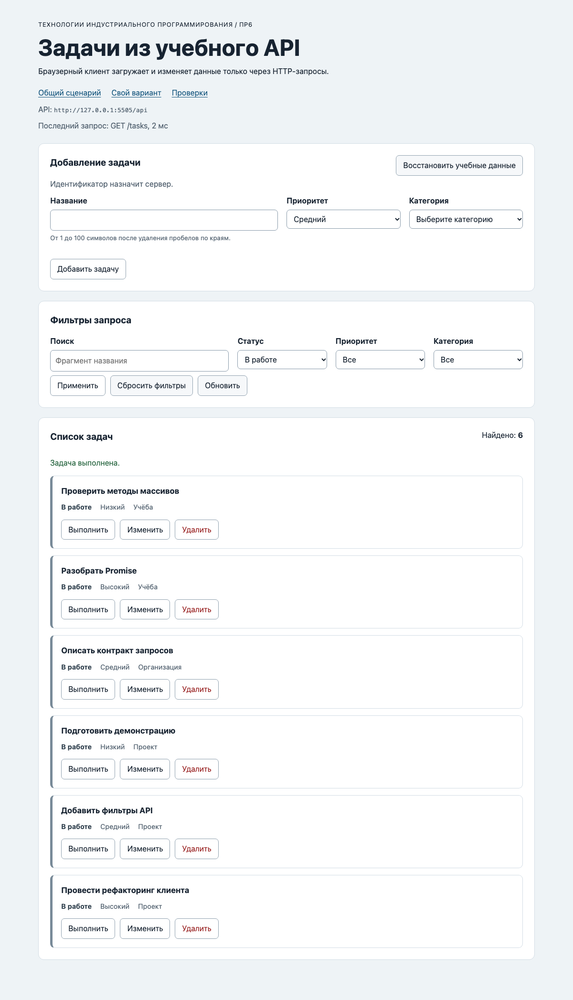

# Отчёт по практической работе № 6

**Тема:** Подключение браузерного приложения к API<br>
**Автор:** Мухамбетов Алим<br>
**Группа:** ЭФБО-13-25<br>
**Вариант:** 1

## 1. Цель работы

Подключить страницу со списком задач к учебному API: загрузка, фильтры, создание, редактирование, смена статуса и удаление идут через HTTP-запросы, а сервер считается источником истины. Получилось приложение без фреймворка, которое показывает состояния загрузки, пустого списка и ошибки, отменяет устаревшие запросы и после каждого изменения заново берёт список с сервера.

## 2. Запуск

**Версии:**

```text
node --version: v24.14.1
npm --version:  11.11.0
```

**Команда запуска:**

```bash
npm start
```

**Адрес приложения:** `http://127.0.0.1:5506/`<br>
**Свой вариант:** `http://127.0.0.1:5506/?dataset=variant`<br>
**Адрес API:** `http://127.0.0.1:5505/api`

Порты не менял. Проверки Node.js: `npm test`, браузерные: `http://127.0.0.1:5506/checks.html` при запущенном `npm start`.

## 3. Реализация

### 3.1. HTTP-клиент

`src/api-client.js` перенесён из ПР5 и расширен. `requestJson` принимает `method` и `body`. Метод приводится к верхнему регистру, разрешены только `GET`, `POST`, `PATCH`, `DELETE`, иначе `TypeError` ещё до сети. `GET` с телом тоже отклоняется. Тело отправляется через `JSON.stringify`, и только тогда добавляется `Content-Type: application/json`. `Accept: application/json` есть всегда.

Порядок разбора ответа: сначала `response.ok` (HTTP-ошибка с полями `status`, `code`, `details`, `url`), потом статус 204 (сразу `null`, тело не читается), потом `Content-Type`, потом `response.json()` в своём `try`. Тайм-аут сделан через `AbortSignal.timeout`, внешняя отмена объединяется с ним через `AbortSignal.any`. По тому, какой сигнал сработал, ошибка получает `kind: "aborted"` или `"timeout"`, а всё остальное при вызове `fetch` становится `"network"`.

### 3.2. Доменный API

`src/task-api.js`: `getTasks`, `getTaskById`, `getCategories`, `loadInitialData` (из ПР5) и новые `createTask` (POST `/tasks`), `updateTask` и `setTaskCompleted` (PATCH `/tasks/:id`), `deleteTask` (DELETE, ожидается строго `null`) и `resetDemoData` (POST `/debug/reset` без тела). У каждого метода последний аргумент `{ signal }`.

До запроса проверяются фильтры и id. После запроса каждая задача проходит `isTask`, категория `isCategory`, в коллекциях id не повторяются и `meta.total` равен длине. Для одной задачи `checkTask` смотрит `payload.data`. Для reset ждём `{ reset: true, total }`. Любое расхождение даёт `ApiError` с `kind: "invalid-response"`.

### 3.3. Состояния интерфейса

Каждая загрузка начинается с `loading` (у панели `aria-busy="true"`). Потом одно из трёх: `ready`, если задачи есть, `empty`, если сервер вернул пустой список, `error` с текстом из `messageForError` и кнопкой повтора. Первая загрузка идёт через `loadInitialData`, она же получает категории. Пока категорий нет (например, API был выключен при открытии), повтор и фильтры снова вызывают `loadInitialData`. Когда категории уже есть, загружается только `getTasks` с текущими фильтрами.

### 3.4. Изменение данных

Все мутации идут через одну внутреннюю функцию `mutate`: блокирует кнопки (`setMutationPending(true)`), вызывает API, показывает сообщение «success», заново грузит список с текущими фильтрами, а в `finally` снимает блокировку. При ошибке показывает текст из `messageForError` с тоном «error».

- Создание: форма проверяется `validateTaskDraft`, на сервер уходят только `title`, `priority` и числовой `categoryId`. id и `completed` назначает сервер.
- Редактирование: `beginEdit` берёт задачу из последнего списка и заполняет форму, сохранение отправляет PATCH без поля `completed`, поэтому статус не меняется.
- Смена статуса: PATCH с `{ completed: !task.completed }`.
- Удаление: DELETE, подтверждение спрашивает `dom-app.js`. Если удалили задачу, которая сейчас редактируется, форма возвращается в режим создания.

Список после мутации я не правлю руками, а беру с сервера, так видно настоящее состояние и действует текущий фильтр.

### 3.5. Защита от устаревшего ответа

Перед каждой загрузкой предыдущий `AbortController` отменяется, а у новой загрузки свой номер `loadNumber`. Когда ответ пришёл, он применяется, только если его номер всё ещё последний. Отмены одной не хватает: ответ мог уже прийти и ждать в очереди микрозадач, когда пользователь сменил фильтр, тогда `abort()` ничего не отменит. Ошибка с `kind: "aborted"` и ошибка устаревшего запроса пользователю не показываются.

### 3.6. Дополнительное задание: длительность последнего запроса

Выбрано задание 5. В `main.js` общий клиент обёрнут функцией `withRequestTiming`: она замеряет `performance.now()` до и после `requestJson` и пишет в шапку строку вида «Последний запрос: GET /tasks, 2 мс» или «..., ошибка network». Предметный API и контроллер не менялись, обёртка просто передаётся в `createTaskApi` вместо клиента. В `index.html` добавлен `#request-info`, в `dom-app.js` метод `setRequestInfo`.

| Проверка | Ожидание | Факт |
|---|---|---|
| Открыть при выключенном API | Время и вид ошибки | «Последний запрос: GET /categories, 37 мс, ошибка network» |
| Обычная загрузка | Несколько миллисекунд | «GET /tasks, 2 мс» |
| Задержка сети 600 мс в DevTools | Около 600 мс | «GET /tasks, 605 мс» |

При начальной загрузке два запроса идут параллельно, поэтому в строке тот, что закончился последним (у меня это был `/categories`).

## 4. Индивидуальный вариант

**Начальный фильтр:** `completed=false`<br>
**Индивидуальный сценарий:** завершить видимую задачу, после повторного GET она пропадает из выборки.

`src/variant.js`: `variantNumber = 1`. Открыл `/?dataset=variant` после восстановления данных:

| Шаг | Ожидание | Факт |
|---|---|---|
| Открыть страницу | Запрос `/tasks?completed=false`, задачи `[4, 7, 13, 19, 22, 28, 34]`, в фильтре «В работе» | `ready`, найдено 7, `[4, 7, 13, 19, 22, 28, 34]`, фильтр статуса `false` |
| Нажать «Выполнить» у задачи 4 | PATCH, затем GET с тем же фильтром, задача 4 пропадает | Сообщение «Задача выполнена.», найдено 6, `[7, 13, 19, 22, 28, 34]` |
| `GET /api/tasks/4` | `completed: true` | `{"id":4,...,"completed":true,...}` |



## 5. Результаты проверок

### 5.1. Автоматизированные проверки Node.js

```text
OK: 01. health возвращает JSON и заголовки CORS
OK: 02. исходный список содержит 12 задач в контрольном порядке
OK: 03. фильтры и поиск применяются совместно
OK: 04. неверный или повторяющийся query даёт 400
OK: 05. POST создаёт задачу, обрезает title и назначает id
OK: 06. созданная задача доступна по id и в списке
OK: 07. POST требует application/json
OK: 08. повреждённый JSON даёт структурированную ошибку
OK: 09. серверная валидация сообщает ошибки полей
OK: 10. PATCH изменяет только переданные поля
OK: 11. PATCH изменяет completed логическим значением
OK: 12. пустой PATCH и неизвестное поле отклоняются
OK: 13. DELETE возвращает 204 без тела
OK: 14. отсутствующая задача даёт 404 для PATCH и DELETE
OK: 15. неверный id даёт 400
OK: 16. категории доступны отдельным ресурсом
OK: 17. HEAD возвращает заголовки без тела
OK: 18. OPTIONS объявляет CORS для изменяющих методов
OK: 19. неподдерживаемый метод даёт 405 и Allow
OK: 20. отладочные маршруты воспроизводят виды ошибок
OK: 21. слишком большое тело запроса отклоняется
OK: 22. reset восстанавливает данные и счётчик id
OK: 23. два экземпляра API не делят изменяемое состояние

Итог API: успешно 23, ошибок 0.
```

```text
OK: 01. buildUrl соединяет baseUrl, путь и кодированный query
OK: 02. buildUrl не изменяет объект query
OK: 03. createApiClient проверяет конфигурацию
OK: 04. GET отправляет Accept, query и AbortSignal
OK: 05. POST сериализует тело и добавляет Content-Type
OK: 06. PATCH поддерживается, а неизвестный метод и body у GET отклоняются
OK: 07. успешный 204 преобразуется в null
OK: 08. JSON-ошибка HTTP сохраняет поля контракта
OK: 09. HTTP-ошибка важнее неверного Content-Type
OK: 10. неверный Content-Type и повреждённый JSON отклоняются
OK: 11. сетевая ошибка сохраняется как cause
OK: 12. тайм-аут отличается от внешней отмены
OK: 13. createTaskApi требует requestJson
OK: 14. getTasks нормализует фильтры и проверяет ответ
OK: 15. getTasks отклоняет неверные фильтры до запроса
OK: 16. loadInitialData параллельно запрашивает задачи и категории
OK: 17. createTask отправляет POST и проверяет задачу
OK: 18. update и смена статуса отправляют PATCH
OK: 19. deleteTask требует ответ 204, reset проверяет подтверждение
OK: 20. доменный API отклоняет неверную схему ответа
OK: 21. validateTaskDraft нормализует корректные данные
OK: 22. validateTaskDraft возвращает ошибки каждого поля
OK: 23. контроллер проверяет зависимости
OK: 24. start отображает loading, категории, задачи и ready
OK: 25. пустой ответ отображает состояние empty
OK: 26. ошибка загрузки отображается, а aborted не показывается
OK: 27. новая загрузка отменяет предыдущую и игнорирует устаревший ответ
OK: 28. невалидная форма не вызывает API
OK: 29. создание блокирует действия, очищает форму и обновляет список
OK: 30. редактирование, toggle и delete используют id текущей задачи
OK: 31. ошибка мутации показывается и снимает блокировку
OK: 32. reset вызывает сервер и перезагружает текущий фильтр
OK: 33. messageForError не раскрывает внутреннюю ошибку

Итог модулей: успешно 33, ошибок 0.
```

```text
OK: 01. начальная загрузка получает задачи и категории
OK: 02. клиент создаёт задачу и получает назначенный id
OK: 03. созданная задача читается по id
OK: 04. редактирование сохраняется на сервере
OK: 05. созданная задача находится серверным поиском
OK: 06. смена статуса видна через фильтр
OK: 07. DELETE удаляет запись и возвращает null
OK: 08. повторное удаление сохраняет код и детали 404
OK: 09. серверная ошибка валидации доступна клиенту
OK: 10. 204 не вызывает ошибку разбора JSON
OK: 11. реальная задержка прерывается по тайм-ауту
OK: 12. внешний AbortController отменяет реальный запрос
OK: 13. повреждённый JSON и text/plain определяются как invalid-response
OK: 14. reset восстанавливает исходный набор

Итог интеграции: успешно 14, ошибок 0.
```

### 5.2. Браузерные проверки

Первый прогон на исходном `checks/browser.checks.js`:

```text
OK: Карточка содержит безопасный текст и три действия
OK: Повторная отрисовка списка не накапливает карточки
OK: Начальная загрузка показывает 12 задач и 3 категории
OK: Фильтры формируют новый серверный запрос
OK: Поиск без результатов показывает empty, а сброс возвращает список
FAIL: Корректная форма создаёт задачу с серверным id — Не найден элемент: [data-task-id="35"]
FAIL: Ошибки формы не отправляют запрос и связаны с полями — Значения отличаются: получено 13, ожидалось 12
OK: Редактирование заполняет форму и сохраняет изменения
OK: Отмена редактирования возвращает режим создания
OK: Смена статуса подтверждается сервером
OK: Удаление подтверждается и сохраняется на сервере
OK: Сброс восстанавливает учебный набор
OK: Недоступный API показывает error и кнопку повтора
OK: Приложение не использует localStorage как источник данных
```

Разобрался, почему падает «Корректная форма создаёт задачу». В ней ожидание написано как `waitFor(() => requireNode(doc, '[data-task-id="35"]'))`, а `requireNode` при отсутствии элемента сразу бросает исключение. `waitFor` его не ловит, поэтому проверка падает на первой же попытке, до ответа сервера, хотя задача потом создаётся. Из за этого же упала следующая проверка: её `resetApi()` успел выполниться раньше, чем дошёл POST из предыдущей, и задач стало 13. Карточку синхронно до ответа сервера показать нельзя, так как id назначает сервер.

Исправил одну строку на `waitFor(() => doc.querySelector('[data-task-id="35"]'), ...)`, так же устроены остальные ожидания в этом файле. Сама проверка не ослаблена: карточка 35, текст, пустая форма и счётчик 13 проверяются как раньше. Повторный прогон:

```text
OK: Карточка содержит безопасный текст и три действия
OK: Повторная отрисовка списка не накапливает карточки
OK: Начальная загрузка показывает 12 задач и 3 категории
OK: Фильтры формируют новый серверный запрос
OK: Поиск без результатов показывает empty, а сброс возвращает список
OK: Корректная форма создаёт задачу с серверным id
OK: Ошибки формы не отправляют запрос и связаны с полями
OK: Редактирование заполняет форму и сохраняет изменения
OK: Отмена редактирования возвращает режим создания
OK: Смена статуса подтверждается сервером
OK: Удаление подтверждается и сохраняется на сервере
OK: Сброс восстанавливает учебный набор
OK: Недоступный API показывает error и кнопку повтора
OK: Приложение не использует localStorage как источник данных
```

### 5.3. Ручные проверки

Сценарии проходил в Chrome, задержку сети ставил через эмуляцию сети DevTools.

| № | Сценарий | Ожидаемый результат | Фактический результат |
|---:|---|---|---|
| 1 | API не запущен | Состояние ошибки и кнопка повтора | `error`, «Нет соединения с учебным API. Проверьте, запущен ли npm start.», кнопка повтора видна |
| 2 | Запустить API и нажать «Повторить» | Загрузка и категории | `ready`, 12 задач, в форме 3 категории |
| 3 | Поиск «такой задачи нет» | Сообщение empty, список без старых карточек | `empty`, «По выбранным условиям задач нет.», найдено 0, карточек в списке 0. «Сбросить фильтры» вернул 12 |
| 4 | Название из пробелов, категория не выбрана | Запрос не отправляется, поля получают сообщения | Ошибки у названия и категории, `aria-invalid="true"`, строка последнего запроса не изменилась, на странице по прежнему 12 задач |
| 5 | Создать «  Подключить форму к API  » и обновить страницу | Созданная задача остаётся на сервере | Задача 35 с обрезанным названием, форма очищена, после F5 найдено 13, `GET /tasks/35` вернул её |
| 6 | Редактировать выполненную задачу 1 | Статус `completed` сохраняется | Новое название и приоритет, `completed: true` на сервере, карточка «Выполнена» |
| 7 | Фильтр «В работе», выполнить задачу 7 | Карточка пропадает после повторного GET | Было 8, стало 7, задачи 7 в списке нет |
| 8 | «Удалить» и «Отмена» в подтверждении | Запроса нет | Карточка 10 на месте, `GET /tasks/10` 200. После «OK» карточки нет, сервер 404 |
| 9 | Быстро два фильтра подряд (низкий, потом высокий) с задержкой 600 мс | Отображается результат последнего запроса | Во время ожидания `loading`, `aria-busy="true"`, в итоге только задачи высокого приоритета `[1, 4, 13, 16, 25, 34, 35]` |
| 10 | Кнопка «Восстановить учебные данные» | Исходный набор | Сообщение «Учебные данные восстановлены.», 12 задач |
| 11 | Добавить задачу, перезапустить API, обновить список | Восстанавливается исходный набор | Было 13, после перезапуска 12, данные хранятся в памяти сервера |
| 12 | Клавиатура: Enter на «Изменить» у задачи 13, Space на «Отменить» | Кнопки работают без мыши | Форма перешла в редактирование «Разобрать Promise» и вернулась в «Добавление задачи» |

Поиск заглушек: `grep -rn "TODO\|Не реализовано" src` ничего не нашёл.

## 6. Ответы на контрольные вопросы

1. **Почему `fetch` обычно не отклоняет Promise при 404 или 500?** Для `fetch` это успешный обмен: сервер ответил, пусть и ошибкой. Promise отклоняется только когда ответа нет совсем (сеть, CORS, отмена). Статус проверяется вручную через `response.ok`.
2. **В каком порядке проверяются `response.ok`, 204, `Content-Type` и JSON?** Сначала `ok`, потому что тело ошибки может быть HTML. Потом 204, у него нет тела. Потом `Content-Type`, и только в конце `response.json()`.
3. **Чем `POST` отличается от `PATCH`?** `POST /tasks` создаёт новую задачу, id и `completed` выбирает сервер. `PATCH /tasks/:id` меняет только переданные поля существующей задачи.
4. **Зачем 201 и `Location`?** 201 говорит, что ресурс создан, а не просто выполнен запрос. `Location` даёт адрес новой задачи, например `/api/tasks/35`.
5. **Почему у 204 не вызывается `response.json()`?** Тела нет, разбор пустой строки бросит `SyntaxError`, и успешное удаление выглядело бы ошибкой.
6. **Когда браузер отправляет preflight и почему `no-cors` не помогает?** Для запросов, которые не считаются простыми: `PATCH`, `DELETE` или `Content-Type: application/json`. Браузер сначала шлёт `OPTIONS` и смотрит разрешающие заголовки. С `no-cors` ответ становится непрозрачным, его тело и статус прочитать нельзя, а `PATCH` и JSON вообще не разрешены.
7. **Чем `empty` отличается от `error`?** `empty` значит, что сервер ответил и задач по фильтру нет, это нормальный результат. `error` значит, что данных мы не получили и не знаем, сколько их, поэтому нужна кнопка повтора.
8. **Почему `localStorage` больше не источник задач?** Данные живут на сервере и общие для всех клиентов. Локальная копия быстро устареет и будет показывать то, чего на сервере уже нет.
9. **Зачем повторно загружать список после мутации?** Сервер может изменить данные по своему (назначить id, обрезать пробелы), а задача может выйти из текущего фильтра. Повторный GET показывает настоящее состояние.
10. **Как возникает гонка при смене фильтра?** Первый запрос медленный, второй быстрый. Второй приходит раньше, а потом первый перезаписывает экран старым результатом.
11. **Почему одного `AbortController` мало?** Если ответ уже получен и ждёт продолжения после `await`, `abort()` его не остановит. Поэтому ещё сравниваю номер загрузки.
12. **Почему отмену не показывают как ошибку?** Её запросил сам код, когда начал новую загрузку. Пользователь ничего неправильного не сделал, а новый результат скоро придёт.
13. **Что проверяет клиент, а что сервер?** Клиент проверяет форму, чтобы сразу подсказать. Сервер проверяет всё заново, потому что запрос можно отправить в обход интерфейса, например через `fetch` в консоли.
14. **Зачем контроллеру `view` параметром?** Контроллер не знает про `document`, поэтому его можно проверить в Node.js с подменённым `view`, как в проверках 24–32.
15. **Почему серверный текст через `textContent`?** Название может содержать HTML. Через `innerHTML` он выполнился бы на странице (проверка с ``), а `textContent` показывает его просто текстом.

## 7. Вывод

Приложение полностью работает через учебный API, все проверки прошли: API 23, модули 33, интеграция 14, браузерные 14 после исправления одной строки в готовой проверке. Вариант 1 работает как в таблице: завершённая задача пропадает из выборки «В работе». Главное, что понял в этой работе: интерфейс не должен сам решать, как выглядят данные после изменения, правильнее спросить сервер, а при быстрой смене фильтров нужно и отменять старый запрос, и проверять, что ответ ещё актуален.
