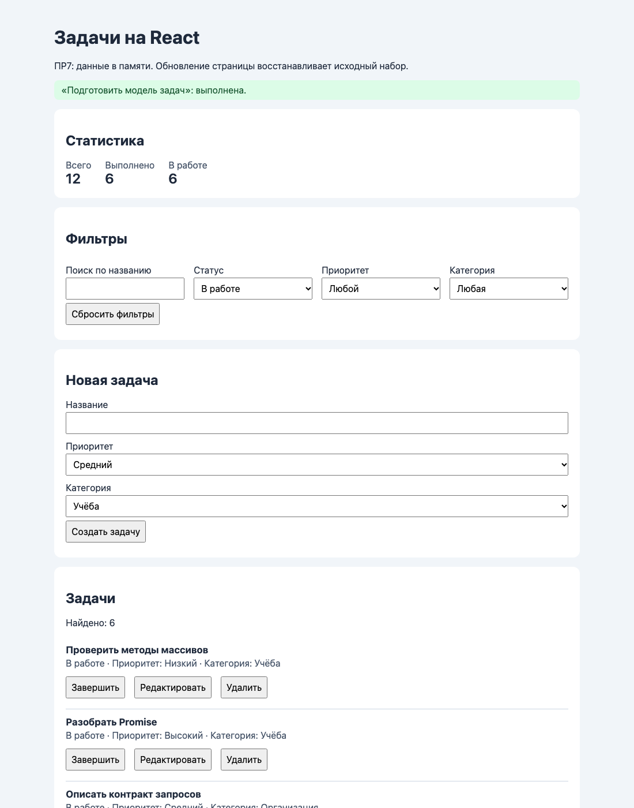
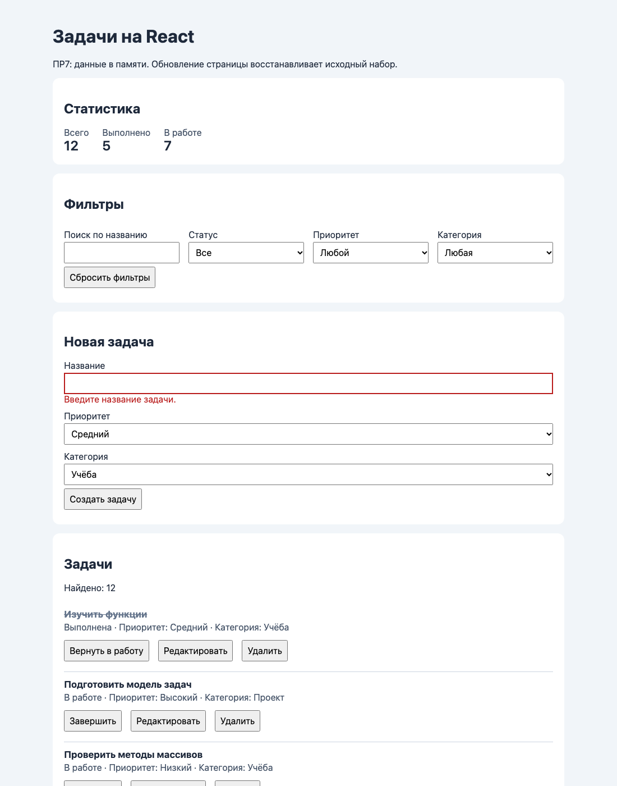

# Отчёт по практической работе № 7

**Тема:** Создание компонентного интерфейса на React<br>
**Автор:** Мухамбетов Алим<br>
**Группа:** ЭФБО-13-25<br>
**Вариант:** 1

## 1. Цель работы

Перенести список задач из ПР6 на React: собрать интерфейс из функциональных компонентов и держать данные в состоянии через `useState`. Получилось приложение, которое показывает задачи с названиями категорий, создаёт и редактирует их с проверкой полей, переключает статус, удаляет после подтверждения, фильтрует по четырём условиям сразу и считает статистику.

Данные живут только в памяти страницы. После перезагрузки возвращается исходный набор из `src/data.js` и начальный фильтр варианта. Так и задумано в ПР7: сервер подключается в ПР8.

## 2. Запуск

**Версии:**

```text
node --version: v24.14.1
npm --version:  11.11.0
```

**Рабочая папка:** `practice-07`

```bash
npm ci
npm run dev
```

**Адрес:** `http://127.0.0.1:5173/`<br>
**Проверки:** `npm test`<br>
**Сборка и просмотр сборки:** `npm run build`, затем `npm run preview` (адрес `http://127.0.0.1:4173/`)

`node_modules` и `dist` в репозиторий не попадают, они в `.gitignore`.

## 3. Реализация

### Файлы

| Файл | Что делает |
|---|---|
| `src/domain/task-service.js` | чистые функции: проверка черновика, выборка, статистика, добавление, правка, переключение, удаление |
| `src/App.jsx` | хранит `tasks`, `filters`, `editingId` и текст сообщения, считает выборку и статистику, содержит обработчики |
| `src/components/TaskStats.jsx` | всего, выполнено, в работе |
| `src/components/TaskFilters.jsx` | поиск, статус, приоритет, категория и кнопка сброса |
| `src/components/TaskList.jsx` | число найденных, карточки или пустое состояние |
| `src/components/TaskItem.jsx` | одна карточка: название, статус, приоритет, категория и три кнопки |
| `src/components/TaskForm.jsx` | черновик, ошибки полей, создание и редактирование |

### Где хранится состояние

- `App` хранит `tasks` (весь массив), `filters` (четыре строки для полей) и `editingId` (id задачи в форме или `null`). Ещё там лежит `notice`, текст последнего сообщения в области `role="status"`.
- `TaskForm` хранит свой черновик `draft`, ошибки `errors` и сообщение об ошибке сохранения.
- Категории не меняются, поэтому это просто импорт из `data.js`, а не состояние.

Данные идут вниз через props. Действия идут вверх через функции: карточка вызывает `onToggle(task.id)`, `onEdit(task.id)` или `onDelete(task.id)`, а `App` меняет массив. `TaskFilters` отдаёт наверх целый новый объект фильтров через `onChange`.

### Производные данные

`visibleTasks = selectTasks(tasks, filters)`, `stats = getTaskStats(tasks)` и `editingTask` считаются прямо в теле `App` при каждом рендере. Отдельного `useState` или `useEffect` для них нет, поэтому список, счётчики и форма не могут разойтись. Статистика считается по всему массиву, а не по выборке.

### Неизменяемые обновления

Все функции из `task-service.js` возвращают новый массив, а изменённую задачу заменяют новым объектом через `map` и `{ ...task, ... }`. Удаление сделано через `filter`, добавление через `[...tasks, task]`. Если id не найден, возвращается тот же массив без изменений. В `App` все изменения идут через функциональную форму `setTasks(previous => ...)`, так что обновление всегда считается от актуального массива.

Новый id считается внутри обновления как максимум id полного массива плюс 1 (для пустого массива это 1). Длину массива брать нельзя: id идут с пропусками (1, 4, 7, ...), и после удаления получился бы повтор.

`confirm` при удалении вызывается до `setTasks`. Функция обновления должна быть чистой: в `StrictMode` React может вызвать её дважды, и тогда окно подтверждения выскочило бы два раза.

### Ключи и сброс формы

У карточек ключ `task.id`. Индекс не подходит: после удаления или фильтрации индексы сдвигаются, и React связал бы состояние не с той карточкой.

Форма получает `key={editingId ?? 'new'}`. Когда пользователь нажимает «Редактировать» у другой задачи, ключ меняется, React создаёт форму заново, и `useState` берёт начальное значение из новой задачи. Черновик прошлой задачи не переносится. После успешной правки `App` ставит `editingId = null`, ключ становится `'new'` и форма возвращается в режим создания.

### Форма

- Поля управляемые: `value` из `draft`, `onChange` обновляет черновик.
- У формы `noValidate`, все проверки делает `validateTaskDraft`, в том числе предел 100 символов (`maxLength` не стоит, иначе 101 символ нельзя было бы ввести).
- При отправке: `preventDefault`, проверка, ошибки всех полей сразу. Если есть ошибка, черновик остаётся и `onSave` не вызывается.
- У неверного поля появляется `aria-invalid="true"` и `aria-describedby` на текст ошибки.
- `onSave` возвращает `true` или `false`. При `false` (задачу удалили, пока она была в форме) показывается сообщение в `role="alert"` и черновик сохраняется.
- Категория из `select` приходит строкой, проверка переводит её в число и не принимает строки вроде `'2x'` или `'1.5'` (регулярное выражение `^\d+$`, а не `parseInt`).

### Безопасный вывод

Название выводится как `{task.title}`. React вставляет его как текст, поэтому `` показывается буквально и ничего не выполняется. `dangerouslySetInnerHTML` нигде нет.

## 4. Индивидуальный вариант

Вариант 1, в `src/variant.js` стоит `variant = 1`. Начальный фильтр: статус «В работе».

| | |
|---|---|
| Исходные условия | после загрузки видно 7 карточек, статистика 12 / 5 / 7 |
| Действие | «Завершить» у первой видимой задачи «Подготовить модель задач» |
| Ожидаемый результат | задача исчезает из выборки, выполнено +1, в работе −1 |
| Фактический результат | задача пропала из списка, статистика стала 12 / 6 / 6 |



## 5. Результаты проверок

### npm test

```text
ℹ tests 28
ℹ pass 28
ℹ fail 0
```

Тесты проверяют только функции из `task-service.js`. React они не запускают, поэтому компоненты проверены вручную по таблице ниже.

### npm run build

```text
✓ 37 modules transformed.
✓ built in 500ms
```

Сборка проходит без ошибок и предупреждений.

### Ручные проверки

Перед каждым сценарием фильтры сбрасывались (кроме 13 и 16). Console проверялась во всех сценариях: ошибок, предупреждений о ключах и о переходе поля из uncontrolled в controlled нет.

| № | Действие | Ожидаемый результат | Фактический результат |
|---:|---|---|---|
| 1 | Сбросить фильтры | 12 карточек, 12 / 5 / 7 | 12 карточек, 12 / 5 / 7 |
| 2 | Название из пробелов | ошибка у названия, массив не меняется, ввод сохраняется | «Введите название задачи.», поле с `aria-invalid`, всего 12, в поле осталось `"   "` |
| 3 | 100, затем 101 символ | первое принято, второе нет | после 100 символов всего 13; на 101 «Название длиннее 100 символов.», всего так и осталось 13 |
| 4 | Создать «  Новая задача  » | пробелы убраны, в работе, форма пустая | карточка «Новая задача», «В работе», поле формы пустое, 13 / 5 / 8 |
| 5 | Отредактировать выполненную задачу | поля новые, статус прежний | «Изучить функции» переименована в «Изучить функции и замыкания», приоритет Высокий, статус «Выполнена», форма снова «Создать задачу» |
| 6 | Правка A, затем «Редактировать» у B | в форме данные B | ввёл «Черновик A» в задаче 1, нажал у задачи 4: форма «Редактирование задачи 4», в поле «Подготовить модель задач» |
| 7 | Изменить поля и отменить | запись не изменилась, форма в режиме создания | «Оформить README» на месте, «Изменено» в списке нет, форма «Новая задача» |
| 8 | Дважды переключить статус | всё вернулось | 12 / 5 / 7, потом 12 / 6 / 6, потом 12 / 5 / 7, статус «В работе» |
| 9 | Отказ от удаления, потом подтверждение | после отказа запись есть, потом удалена | после отказа осталась (всего 12), после подтверждения удалена (всего 11) |
| 10 | Удалить редактируемую запись | форма в режиме создания | было «Редактирование задачи 19», стало «Новая задача» |
| 11 | Все четыре фильтра | только подходящие под все условия | «под» + в работе + высокий + Проект: одна карточка «Подготовить модель задач» |
| 12 | Поиск без совпадений, потом сброс | пустое состояние, потом весь список | «Нет задач, подходящих под выбранные фильтры.», после сброса 12 карточек |
| 13 | Создать запись не под фильтры | счётчик вырос, карточки нет | фильтр «Высокий», создал задачу с низким приоритетом: 12 / 5 / 7, потом 13 / 5 / 8, карточки нет; после фильтра «Низкий» карточка видна |
| 14 | Название `` | текст, код не выполняется | в карточке буквальный текст, элемента `img` нет, окна alert не было |
| 15 | Удалить всё, создать новую | пустой список, нули, создание работает | «Задач пока нет. Создайте первую в форме выше.», 0 / 0 / 0; после создания одна карточка, 1 / 0 / 1 |
| 16 | Перезагрузить страницу | исходный набор и фильтр варианта | 12 / 5 / 7, фильтр статуса «В работе», 7 карточек |
| 17 | Форма и кнопки с клавиатуры | видимый фокус, подписи, всё без мыши | у всех 30 полей и кнопок есть подписи, ни один не выключен из Tab, фокус виден по синей рамке `:focus-visible` |
| 18 | Сценарий варианта в preview | как в dev | весь протокол 1–17 и вариант повторены на `npm run preview`, результаты совпали с dev-режимом |



## 6. Ответы на контрольные вопросы

1. JSX превращается в вызовы функций React, а не в строку. В нём `className` вместо `class`, `htmlFor` вместо `for`, теги обязательно закрываются, а в `{}` пишется любое выражение JS. Текст из `{}` экранируется.
2. Props приходят от родителя, компонент их только читает. Состояние компонент хранит сам и меняет через функцию из `useState`.
3. Обычная переменная создаётся заново при каждом вызове компонента, и её изменение не вызывает перерисовку. `useState` сохраняет значение между рендерами и просит React перерисовать компонент.
4. Когда новое значение считается от старого: `setTasks(previous => toggleTask(previous, id))`. Так берётся актуальное значение, даже если обновлений несколько подряд.
5. Копия массива через `[...tasks]` содержит те же объекты. Если поменять `copy[0].completed`, поменяется и объект в старом массиве, и React может не увидеть изменения. Нужно создать новый объект `{ ...task, completed: true }`.
6. Ключ связывает элемент списка с его состоянием в React. Индекс сдвигается после удаления или фильтрации, а `id` нет.
7. Они полностью считаются из `tasks` и `filters`. Если хранить их отдельно, после каждого действия пришлось бы обновлять три состояния, и легко забыть одно.
8. Родитель передаёт функцию через props, ребёнок вызывает её с нужными данными: `onDelete(task.id)`.
9. Значение поля берётся из состояния (`value`), а изменения идут через `onChange` в состояние.
10. `select` всегда отдаёт строку `'2'`, а в задачах `categoryId` число `2`. Без преобразования `'2' === 2` даёт `false`.
11. При смене `key` React считает форму новым компонентом: старое состояние выбрасывается, `useState` снова берёт начальное значение.
12. Функция обновления должна быть чистой. React (особенно в `StrictMode`) может вызвать её несколько раз, и окно подтверждения появилось бы повторно.
13. По общему числу задач: если `tasks.length === 0`, задач нет совсем; если задачи есть, а выборка пустая, то ничего не подошло под фильтры. Я передаю в `TaskList` проп `total` и показываю разные сообщения.
14. `npm test` проверяет чистые функции: валидацию, фильтры, статистику и операции с массивом. Компоненты, клики, форму и вывод на экран он не проверяет.
15. Вместо операций над массивом в памяти `App` будет вызывать HTTP-модули из ПР5–ПР6. Начальная загрузка уйдёт в `useEffect`, появятся состояния загрузки и ошибки, а `onSave` станет асинхронным и будет возвращать Promise.

## 7. Вывод

Перенёс приложение задач на React: разделил его на пять компонентов, оставил одного владельца данных (`App`) и считаю выборку и статистику из состояния, а не храню их отдельно. Все изменения массива сделаны без мутаций, форма сбрасывается через `key`. Все 28 тестов проходят, сборка собирается, ручной протокол из 18 сценариев выполнен в dev и в preview. В ПР8 нужно заменить операции в памяти на запросы к API и сделать сохранение асинхронным.
