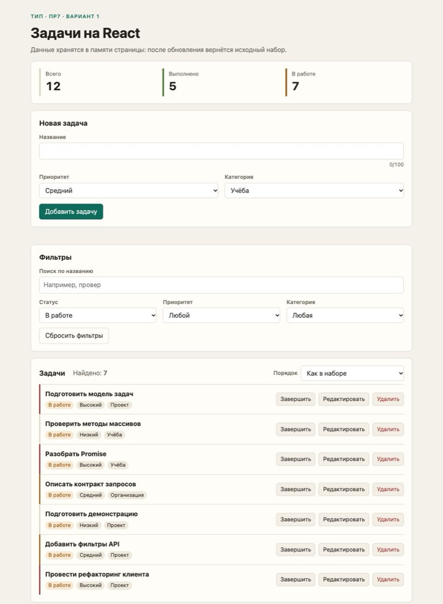

# ПР7. Компонентный интерфейс задач на React

| | |
|---|---|
| Автор | Мухамбетов Алим, ЭФБО-13-25 |
| Вариант | 1: начальный фильтр «В работе» (`completed: 'false'`) |
| Окружение | macOS 26.5.1, Node.js v24.14.1, npm 11.11.0, React 19.3.0, Vite 7.3.6, Chrome 156 |
| Проверено | 02.11.2026: `npm test` 32/32 (28 заготовки и 4 своих), сборка без предупреждений, ручной протокол 22/22, консоль пустая |
| Расширение | порядок списка: как в наборе, по названию, по убыванию приоритета |



## Цель и результат

Цель: собрать интерфейс списка задач из компонентов React. Состояние хранится в одном
месте, данные меняются только новыми объектами, а всё, что можно вычислить, считается
при рендере.

Результат: задачи можно создавать, править, переключать и удалять с подтверждением.
Список фильтруется по четырём полям и сортируется. Статистика всегда считается по
всему набору. Данные живут в памяти страницы. Ни `localStorage`, ни сервера, ни
`useEffect` в работе нет.

## Запуск

```bash
cd practice-07
npm ci
npm run dev        # http://127.0.0.1:5173/
npm test           # node --test checks/*.test.js
npm run build      # сборка в dist/
npm run preview    # просмотр сборки, http://127.0.0.1:4173/
```

## Как устроено

| Файл | Отвечает за |
|---|---|
| `src/domain/task-service.js` | чистые функции: проверка черновика, выборка, статистика, добавление, правка, переключение, удаление, `nextTaskId`, `sortTasks` |
| `src/App.jsx` | всё состояние и обработчики, вычисление выборки и статистики |
| `src/components/TaskStats.jsx` | три числа по полному набору |
| `src/components/TaskForm.jsx` | черновик, ошибки, создание и правка |
| `src/components/TaskFilters.jsx` | четыре управляемых поля и сброс |
| `src/components/TaskList.jsx` | счётчик «Найдено», порядок, пустые состояния, карточки по `key = task.id` |
| `src/components/TaskItem.jsx` | одна карточка и три кнопки действий |
| `src/components/labels.js` | подписи приоритетов, общие для формы, фильтров и карточек |

```
                 App  (tasks, filters, editingId, sort, notice)
                  │
   ┌──────────────┼───────────────┬──────────────────┐
   │ stats        │ initialTask   │ filters          │ visibleTasks
   ▼              ▼ key           ▼                  ▼
TaskStats      TaskForm        TaskFilters        TaskList ── TaskItem × N
                  │ onSave(value) → true/false      │ onSortChange
                  │ onCancel     │ onChange(next)    │ onToggle / onEdit / onDelete (id)
                  └──────────────┴───────────────────┴──────► обработчики App
                                                              setTasks(previous => …)
```

Кто владеет состоянием:

| Состояние | Владелец | Почему там |
|---|---|---|
| `tasks`, `filters`, `editingId`, `sort`, `notice` | `App` | нужны нескольким компонентам |
| черновик и ошибки формы | `TaskForm` | никому, кроме формы, не нужны до отправки |
| `visibleTasks`, `stats`, `editingTask` | никто, вычисляются при рендере | иначе две копии одних данных разойдутся |

### Неизменяемые обновления, ключи, сброс формы

- Все изменения идут через функции домена. Они возвращают новый массив, где новый объект
  есть только у изменённой задачи, а остальные ссылки те же. Это проверяет собственный
  тест О3.
- Обновления функциональные: `setTasks(previous => …)`. Новый `id` считается внутри
  обновления как `nextTaskId(previous)`, то есть максимум плюс один. От длины массива он
  не зависит, поэтому после удаления id не повторяются.
- У карточки `key = task.id`. Индекс не годится: после фильтра или сортировки React
  связал бы состояние строки с чужой задачей.
- Ключ формы: `edit-<id>` при правке, `create` при создании. Смена ключа монтирует
  новую форму, и черновик заново берётся из `initialTask`. Так переход «правка A →
  правка B» показывает B (сценарий 6), а после удаления редактируемой задачи
  открывается пустая форма создания (сценарий 10).
- `window.confirm` вызывается до `setTasks`. Функция обновления остаётся чистой и не
  спрашивает дважды, хотя `StrictMode` в dev вызывает её два раза.
- `onSave` возвращает `false`, если редактируемой задачи уже нет. Тогда форма
  сохраняет черновик и показывает сообщение в `role="alert"`.

### Доступность

- Сообщения об ошибках связаны с полями через `aria-describedby`, а у неверного поля
  стоит `aria-invalid`.
- Итог действия попадает в `role="status"`.
- У кнопок карточки `aria-label` с названием задачи.
- Фокус видно по рамке 3 px.
- Форма с `noValidate` и без `maxLength`: так ошибку на 101 символ можно увидеть,
  браузер не обрезает ввод.

## Вариант 1

`createInitialFilters()` возвращает `completed: 'false'`. Поэтому при старте видны
7 невыполненных задач из 12, а в фильтре «Статус» выбрано «В работе».

Если завершить видимую задачу, она пропадает из выборки: «Найдено» уменьшается
с 7 до 6. Статистика меняется с 12/5/7 на 12/6/6, потому что считается по всем
задачам. Сценарий проверен на собранной версии в `npm run preview` (сценарий 18) и
отдельным тестом О4.

## Проверки

| Проверка | Результат | Лог |
|---|---|---|
| `npm test` | 32/32: 28 тестов домена из заготовки и 4 своих | `output/node-checks.txt` |
| `npm run build` | собрано без предупреждений, JS 236 КБ (gzip 74 КБ) | `output/build.txt` |
| Ручной протокол §9.3 | 22/22: пример Counter, 18 сценариев (первый в двух частях), расширение и консоль | `output/manual-protocol.txt` |
| Ширина 390 px | `scrollWidth = 390`, горизонтальной прокрутки нет | — |
| `rg -n "TODO\|Не реализовано" src` | пусто | — |

Ручной протокол прогнан через Chrome DevTools Protocol: настоящие щелчки мышью, ввод
через `Input.insertText` и Tab с клавиатуры. `confirm` и `alert` подменены и считают
вызовы. Сценарии 1–17 выполнены на `npm run dev`, сценарий 18 на `npm run preview`.

| № | Сценарий | Ожидание | Факт | Итог |
|---|---|---|---|---|
| 0 | Counter: два экземпляра, шаги 1 и 5 | второй считает отдельно | 0 и 10 после двух щелчков по второму | совпало |
| 1 | старт и сброс фильтров | 7 карточек, затем 12; статистика 12/5/7 | 7 → 12, 12/5/7, все фильтры пустые | совпало |
| 2 | название из пробелов | ошибка, `aria-invalid`, черновик цел | «Введите название задачи.», пробелы в поле остались | совпало |
| 3 | 101 и 100 символов | 101 — ошибка, 100 — сохраняется | «Не длиннее 100 символов, сейчас 101.», затем 13/5/8 | совпало |
| 4 | «  Новая задача  » | без краевых пробелов | «Новая задача» | совпало |
| 5 | правка выполненной задачи | статус «Выполнена» остаётся | остался, форма вернулась к созданию | совпало |
| 6 | правка A, затем B | форма показывает B | «Редактирование задачи № 7», название B | совпало |
| 7 | отмена правки | пустая форма создания, задача цела | так и есть, сообщение об отмене | совпало |
| 8 | переключение дважды | 14/6/8, затем 14/5/9 | 14/6/8 → 14/5/9 | совпало |
| 9 | удаление: отказ, затем согласие | после отказа задача на месте | на месте, затем удалена; вопросов 2 | совпало |
| 10 | удаление редактируемой задачи | форма возвращается к созданию | вернулась, 12/5/7 | совпало |
| 11 | четыре фильтра | каждый сужает по своему полю | «ПРО» 3, выполненные 5, высокий 4, «Проект» 5 | совпало |
| 12 | поиск без совпадений и сброс | пустое состояние про фильтры | «Под выбранные фильтры ничего не подходит…», после сброса 12 | совпало |
| 13 | новая задача мимо фильтра «Выполненные» | счётчик растёт, карточки нет | 13/5/8, найдено 5, карточки нет | совпало |
| 14 | `` | показан текстом | текст, `img` 0, `alert` 0 | совпало |
| 15 | удалить все, затем создать | 0/0/0 и «Задач пока нет», затем 1/0/1 | 0/0/0, «Задач пока нет…», затем 1/0/1 | совпало |
| 16 | обновить страницу | исходный набор и фильтр варианта | 12/5/7, «В работе», 7 карточек | совпало |
| 17 | клавиатура | Tab до поля, Enter отправляет, фокус виден | первый Tab на «Название», Enter → 13/5/8, рамка `solid 3px` | совпало |
| 18 | вариант в preview | задача уходит из выборки | 12/5/7, найдено 7 → 12/6/6, найдено 6 | совпало |
| Р | порядок списка | высокий сверху; алфавит по-русски | совпало с `Intl.Collator('ru')` | совпало |
| К | консоль dev и preview | без предупреждений | пусто в обоих | совпало |

Пример `examples/Counter.jsx` смонтирован дважды на временной странице с шагами 1 и 5.
Счётчики не влияют друг на друга, потому что у каждого экземпляра своё состояние.
После проверки временная страница удалена, в `App` пример не подключался.

Скриншот снят после протокола, когда сетка фильтров была перестроена с двух колонок на
три. Правка касалась только CSS, поведение не менялось. После неё повторены `npm test`
и сборка.

## Собственные случаи (`checks/own.test.js`)

| № | Что проверяет |
|---|---|
| О1 | `nextTaskId`: 1 для пустого списка, максимум плюс один, удаление первой задачи не меняет следующий id |
| О2 | `sortTasks` не меняет вход; режим `none` и неизвестный режим возвращают тот же массив; порядок по названию и по приоритету |
| О3 | цепочка «создать → изменить → завершить → удалить» возвращает исходные id, нетронутые задачи переиспользуются по ссылке |
| О4 | вариант 1: завершённая видимая задача уходит из выборки, «Выполнено» растёт на 1 |

## Расширение: порядок списка

`sortTasks(tasks, sort)` возвращает новый массив (`toSorted`). Названия сравнивает
`Intl.Collator('ru')`, приоритет идёт от высокого к низкому. При одинаковом ключе
сохраняется исходный порядок.

Порядок хранится в `App` рядом с фильтрами и применяется к готовой выборке:
`sortTasks(selectTasks(tasks, filters), sort)`. Статистику он не меняет, сброс
фильтров его не трогает.

## Ответы на контрольные вопросы

1. **JSX и строка HTML.** JSX — это выражения JavaScript, которые собираются в вызовы
   `jsx()` и дают объекты-описания элементов. Значения в фигурных скобках React
   вставляет как текст, поэтому `` в названии остаётся текстом (сценарий 14).
   Строку HTML пришлось бы разбирать через `innerHTML`, и разметка бы выполнилась.
   В JSX свои имена атрибутов (`className`, `htmlFor`), и обработчики передаются
   функциями.
2. **Props и состояние.** Props приходят от родителя, и компонент их только читает.
   Состояние принадлежит компоненту, меняется через `set…`, и каждая смена вызывает
   рендер. Например, `tasks` — состояние `App`, а для `TaskList` это props.
3. **Обычная переменная вместо `useState`.** Между рендерами она не сохраняется: функция
   компонента вызывается заново, и значение начинается сначала. Присваивание не
   просит React перерисовать экран.
4. **Функциональная форма обновления.** Она нужна, когда новое значение зависит от
   прежнего: `setTasks(previous => toggleTask(previous, id))`. React отдаёт последнее
   состояние с учётом обновлений из очереди, а значение из замыкания могло устареть.
5. **Мутация объекта в поверхностной копии.** Копия массива ссылается на те же объекты.
   Если поменять объект задачи, изменится и прежнее состояние. Сравнение ссылок
   перестанет видеть разницу, а `StrictMode` с двойным вызовом получит уже
   изменённые данные. Поэтому меняется только новый объект задачи.
6. **Стабильный `key`.** По ключу React понимает, какая строка какой задаче
   соответствует. Индекс меняется при фильтре, сортировке и удалении, и DOM вместе с
   состоянием строки перешёл бы к другой задаче. `task.id` от положения в списке не
   зависит.
7. **Выборка и статистика без своего состояния.** Обе однозначно вычисляются из `tasks`
   и `filters`. Отдельная копия требовала бы синхронизации на каждом изменении и при
   первой же ошибке разошлась бы с данными. Вычисление на 12–100 задачах ничего не стоит.
8. **Как дочерний компонент сообщает о действии.** Он вызывает функцию из props:
   `onToggle(task.id)`, `onChange(nextFilters)`, `onSave(value)`. Решает и меняет
   состояние родитель.
9. **Управляемое поле.** Его значение задаёт `value` из состояния, а каждое изменение
   проходит через `onChange` и `set…`. Источник правды — состояние, а не DOM.
10. **`categoryId` из `select`.** `value` у `select` всегда строка, а в данных
    `categoryId` — число. `validateTaskDraft` переводит строку в число через
    `toCategoryId` (только цифры) и проверяет, что такая категория есть. Иначе
    сравнение `'2' === 2` в фильтре и при поиске названия категории не сработает.
11. **Смена ключа формы.** React размонтирует старый экземпляр и монтирует новый. Всё
    локальное состояние, то есть черновик и ошибки, создаётся заново из начального
    значения `useState(() => createDraft(initialTask))`.
12. **`confirm` вне функции обновления.** Функция обновления должна быть чистой: React
    может вызвать её повторно (в `StrictMode` вызывает дважды) или отложить.
    Модальный вопрос внутри неё был бы побочным эффектом, и пользователя спросили бы
    два раза.
13. **Нет задач или нет совпадений.** `TaskList` получает и выборку, и `totalCount`.
    При `totalCount === 0` выводится «Задач пока нет», при пустой выборке и непустом
    наборе — «Под выбранные фильтры ничего не подходит» (сценарии 12 и 15).
14. **Что проверяет `npm test`.** Только чистый домен: проверку черновика, выборку,
    статистику, неизменяемые операции, а также мои тесты сортировки, id и варианта.
    Рендер, обработчики, ключи формы, доступность, `confirm` и консоль он не
    проверяет. Это закрывает ручной протокол.
15. **Что изменится для API в ПР8.**
    - Исходные `tasks` и `categories` будут загружаться с сервера, и появятся состояния
      «загрузка», «ошибка», «готово».
    - Обработчики станут асинхронными: создание, правка и удаление пойдут запросами,
      `id` будет выдавать сервер, поэтому `nextTaskId` уйдёт.
    - `onSave` будет возвращать промис, и форма будет ждать ответа.
    - Фильтры можно будет передавать серверу.
    - Компоненты отображения и функции проверки останутся почти без изменений.

## Вывод

Интерфейс разделён на пять компонентов, состояние хранится только в `App`, и все
изменения идут через чистые функции домена. Благодаря этому тесты проверяют логику без
браузера, а компоненты только показывают данные и передают события наверх.

Самые тонкие места — ключ формы, функциональные обновления и `confirm` вне функции
обновления. Именно на них ломаются сценарии 6, 10 и 15, и все три проходят. Вариант 1
показывает, зачем статистика и выборка считаются отдельно: задача исчезает из списка,
а счётчик «Выполнено» растёт.
